# SDE Interview RAG: Design Document

> Status: reviewed; being implemented milestone by milestone (progress: [PROGRESS.md](PROGRESS.md)). Chinese version: [DESIGN.zh-CN.md](DESIGN.zh-CN.md).
> Reference: a set of preparation notes for "System design interview: design a RAG system" (called "the reference document" below), covering the topics interviewers probe, such as chunking, hybrid retrieval, permissions, evaluation, and reliability.

---

## 0. Summary

- **Two pipelines plus an evaluation loop**, matching Part 3 of the reference document. The offline **ingestion pipeline** crawls, cleans, extracts questions, tags, deduplicates and merges, embeds, and indexes. The online **query pipeline** understands the query, runs hybrid retrieval, reranks, judges whether the context is sufficient, generates an answer with citations, and has the answer reviewed. On top of these come **quality monitoring, offline evaluation, and agent capability tests**.
- LangGraph runs three graphs: `ingest` (crawls once every 12 hours), `query` (the query service), and `evaluate` (nightly evaluation). There is also a suite of **agent capability tests**. It is both a pytest test suite and the **preflight gate** that runs before every scheduled crawl. When a model falls below its capability thresholds, the system degrades automatically instead of producing garbage data.
- **Reviewer**: `claude -p` (Sonnet 5.5) judges whether the domain knowledge and the solution in an answer are correct. It reviews query answers, source answers, and offline reference answers. Its verdicts are shown in the UI and also serve as an evaluation metric (Section 7.6).
- **Everything is persisted**: raw content, cleaned data, questions and tags, the FTS5 index, vectors, and index snapshots are all written to disk. A restart does not require re-crawling, re-cleaning, or re-embedding anything (Section 7.1).
- **No repeated downloads**: a connector first fetches the listing, filters it against the "already seen" records, and downloads only bodies that are new or have changed. Conditional requests and content hashes back this up, and the repeated-download rate is a monitored metric (Section 3.2).
- **Stall detection**: the latency budget is relaxed, but the system distinguishes "slow" from "stalled". The decision is based on progress signals (the gap between streamed tokens, heartbeats, runaway output) rather than total duration. When a stall is detected, the system degrades automatically, sends an alert, and lets the next run resume from the last checkpoint (Section 7.5).
- **Identity and permissions**: login and permission isolation are not implemented yet, but **the interfaces and data fields are already in place**. Adding them later only requires swapping the implementations, not changing the retrieval code (Section 4.3).
- **Small scale**: an estimated 60,000 retrieval units and about 250 MB of vectors, which fit entirely in memory for exact search. No ANN index or vector database is needed. The bottleneck is **the throughput of question extraction with the local LLM** (a single slot), so structured sources are parsed with rules wherever possible, and the LLM only handles unstructured interview experience posts.
- **The agent used by every role is configurable**: roles such as extraction, tagging, routing, generation, and reviewing only refer to a "backend" name from the configuration. No model name or service address is hardcoded. Running on a different machine or by a different person only requires changing that machine's override configuration (Section 5.3).
- **A standalone project that produces standard LangGraph workflows**: it depends only on public PyPI packages, not on any other private project. The three graphs are registered in `langgraph.json` and can be loaded by any LangGraph runtime (`langgraph dev`, LangGraph Server, or this project's own command line). The runtime conventions are described in Section 5.6.
- **Single-machine setup**: SQLite (data, FTS5, vectors, logs), fastembed (embedding and reranking on the CPU), a Gradio UI, and systemd timers (which can be replaced by LangGraph Server's scheduled jobs). Calling CLI agents, sending alerts, and driving a headless browser are all implemented inside this project.

---

## 1. Requirements and Assumptions

| Question | Assumption | Design affected |
|---|---|---|
| Who are the users | A single user (or a few people), on the local machine or the local network | **No login, multi-tenancy, or permission isolation for now, but the interfaces and data fields are kept** (Section 4.3) |
| Data sources | Public web pages and APIs; **never bypass logins or verification**. 1Point3Acres (一亩三分地) is crawled at low frequency with a dedicated, logged-in browser profile | Connector list (Section 3); Glassdoor is not crawled |
| Language | Sources are mostly in English; users may ask in Chinese or English; **answers use the language of the question** | Multilingual embedding model; query understanding generates English search terms |
| Scale | About 50,000 raw questions, about 20,000 after merging | Single-machine, in-memory index (Section 2) |
| Freshness | **Updated every 12 hours** | Two scheduled crawls per day, no streaming ingestion; incremental crawling without repeated downloads (Section 3.2) |
| Latency | **Relaxed**: with the gateway model, the first token within 15 seconds and the full answer within 90 seconds; after falling back to the local model, the first token within 45 seconds and the full answer within 180 seconds | Streaming output; **stalls are detected from progress signals** rather than failing on total duration (Section 7.5) |
| Cost of errors | Low (it is for interview preparation), but the system **must not invent claims that "company X really asked this", and must not teach wrong knowledge** | Source-backed content and model-supplied content (the "模型补充" (Model supplement) section) are labeled separately (Section 5.5); citation verification; the reviewer (Section 7.6) |
| Cost | The local model is not metered; the gateway is rate-limited (0.5 req/s); the Claude subscription quota is limited | All batch work runs locally; the gateway is used for query-time generation; Claude reviews have a daily cap |

**The key difference from enterprise RAG**: for many questions (especially LeetCode-style questions and those from interview experience posts), **the sources contain no answer**, and "how to solve it" often has to come from the model's own knowledge. So this system cannot copy the enterprise rule of "refuse to answer when nothing is found". Instead, **the questions and how they are asked come from the sources; the solution may be supplied by the model, but the answer must label which content is backed by sources and which is supplied by the model, and the reviewer checks correctness**.

---

## 2. Scale Estimates (all numbers are assumptions, to be replaced with measurements after implementation)

| Item | Assumption / calculation | Result |
|---|---|---|
| Interview-prep question banks (about 25 GitHub question-bank repositories) | 800 questions per repository on average | About 20,000 questions (rule-based parsing, no LLM) |
| Initial backfill of interview experience posts | About 3000 posts from LeetCode Discuss (measured: `totalNum=3000` under that tag), plus about 2000 from Reddit, HN, dev.to, Medium, and 1Point3Acres | About 5000 posts |
| Questions extracted from experience posts | 3 to 8 per post | About 25,000 questions |
| Increment every 12 hours | 25 to 75 new posts | About 250 questions |
| Retrieval units (chunks) | About 45,000 question units plus about 15,000 experience-post body chunks | About 60,000 |
| Vector memory | 60,000 × 1024 dimensions × 4 bytes | **About 250 MB**, kept in memory |
| Exact search | 60,000 × 1024 multiply-adds ≈ 60 million FLOP | Milliseconds per query; **no ANN needed** |
| Cleaned body text | 5000 posts × about 10 KB, plus the parsed question banks | About 100 MB, stored in SQLite |
| Question extraction with the local LLM | About 15 seconds per post (thinking off, about 2k input tokens), single slot | Backfilling 5000 posts takes about 21 hours, so **each run is capped at 300 posts** (about 75 minutes). With two runs per day, the backfill finishes in about 9 days; after that, each incremental run takes about 15 minutes |
| Tagging with the local LLM | Batches of 20 questions, about 8 seconds per batch | About 5 hours once (spread over the backfill period); a few minutes per incremental run |
| Embedding (CPU, multilingual-e5-large) | Assumed 20 to 50 chunks per second | 20 to 50 minutes the first time; under 1 minute per incremental run |
| Claude reviews | 15 to 60 seconds per call; 5 questions per call when reviewing source answers in batches | Daily cap of 120 calls by default (configurable) |
| Query QPS | Single user | About 0; **the bottleneck is LLM latency, not retrieval** |

Design conclusions drawn from these numbers:

1. The authoritative copy of the vectors is stored in SQLite (as BLOBs). A numpy snapshot is also saved and memory-mapped at startup for **exact search**. When filtering by tag or company, the search runs by brute force directly on the subset (reference document, experiment 3: when the visible set is small, exact search is both fast and accurate). A `VectorIndex` interface is kept so that sqlite-vec, Qdrant, or pgvector can be swapped in if the scale grows.
2. LLM question extraction is the ingestion bottleneck: **a source that can be parsed with rules is never sent to the LLM**. The LLM stages advance in batches from a queue and can be interrupted and resumed (Section 6).

---

## 3. Data Sources (Connectors)

### 3.1 Source list

"Crawling the whole web" is implemented as **a set of pluggable connectors** plus search-based discovery. Each connector handles incremental fetching from one source, and adding a source only requires a new connector and one line of configuration. The reachability results in the table below were measured on the development machine on 2026-10-31.

| Source | Type | Access method | Measured | Parsing | Enabled |
|---|---|---|---|---|---|
| GitHub question-bank repositories (tech-interview-handbook, system-design-primer, interview-questions repositories for each language or framework, ML/LLM interview repositories, and so on) | Prep questions plus answers | `gh api` / raw files | 200, `gh` is logged in | **Rules** (Markdown headings, lists, and `<details>` Q&A structures); handed to the LLM only when parsing fails | M1 |
| Hacker News | Interview experience discussions | Algolia API | 200 | LLM extraction | M1 |
| dev.to | Interview experiences plus prep articles | Public API, `?tag=interview` and similar | 200 | Body extraction plus LLM | M1 |
| LeetCode Discuss (interview-experience / interview-question) | Interview experiences | GraphQL `ugcArticleDiscussionArticles` (unofficial API) | 200 | LLM extraction | M2 (low rate) |
| Medium | Interview experiences plus prep articles | Tag RSS for discovery (snippets only); the full text from the author's feed (article pages return 403 to plain requests) | 200 | Feed body plus LLM | M2 |
| Reddit (r/leetcode, r/cscareerquestions, r/ExperiencedDevs, and others) | Interview experiences | Subreddit search RSS for titles containing "interview" (the JSON API returns 403); the post text is in the feed; 20 seconds between feeds (8 seconds got 429) | RSS 200 | LLM extraction | M2 |
| 1Point3Acres | Chinese-language interview experiences (high quality) | Headless Chrome with a dedicated, logged-in profile (Section 3.4) | Direct requests return 403 | LLM extraction (Chinese original; questions normalized into English) | M2 (low frequency) |
| Stack Exchange | A small number of concept questions | Official API | 200 | Rules | Optional |
| Glassdoor | Interview experiences | Terms of service forbid crawling; behind a login wall | — | — | Not planned |
| Arbitrary blogs / articles | Both types | Links discovered through Google News / HN search, then body text extracted with trafilatura | — | LLM | Later |

**Crawling rules**: respect robots.txt; rate-limit each domain separately (1 request every 2 seconds by default, configurable per source); honor `Retry-After`; use a fixed, honest User-Agent; never bypass logins or CAPTCHAs; store the source URL for citations, and show only excerpts plus links in the UI.

**Fetching tiers**: plain HTTP requests first, then headless Chrome (this project's `sde_rag.browser`, based on Playwright, for sites behind Cloudflare). Optional later: let a CLI agent browse through Playwright MCP as a fallback when a source keeps failing.

### 3.2 Incremental crawling without repeated downloads

The goal is that **each run downloads only content that is new or has changed**. Instead of only deduplicating after downloading, existing content is filtered out before the body is downloaded.

1. **Listing first, bodies second**: a connector works in two steps. The first step, `list_updates()`, fetches only the listing (title, ID, URL, update time), which is cheap. The framework filters it against the `seen_items` table, and the second step, `fetch_doc()`, downloads only the new items, plus the items whose listed update time is later than the previous fetch.
2. **"Already seen" records** (the `seen_items` table): the key is `(source, external_id)`, and there is also a unique index on the **normalized URL** (tracking parameters, `www`, trailing slashes, and fragments removed). Each record stores when the item was first and most recently seen, the update time reported by the source site, the ETag / Last-Modified values, and the content hash.
3. **High-water mark with an overlap window**: each source stores the newest publish time or ID it has fetched (the cursor). The next run looks back 24 hours from the high-water mark so that posts that show up late are not missed. The overlapping part is filtered by `seen_items`, so its bodies are not downloaded again.
4. **Conditional requests**: for GitHub, the latest commit SHA of the repository is compared first; if there is no new commit, the whole repository is skipped. If there are new commits, only files whose blob SHA has changed are downloaded. RSS feeds and web pages use ETag / If-Modified-Since, and nothing is downloaded when the server returns 304.
5. **Content hash as a backstop**: the hash is still computed after the body is downloaded. If it matches the existing version, the item is marked `unchanged` and skips all later processing.
6. **Cross-source deduplication**: Reddit and HN posts are often just links to articles on Medium or a blog. The outbound URL is normalized and looked up in `seen_items` first. If it is already there, the system only records one more "reference" (which counts toward popularity) and does not download the body again. Reposted or lightly edited articles are found as near-duplicates with SimHash and grouped into the same document group.
7. **Question-level deduplication** happens after extraction (Section 6.4).

The monitored metric is the **repeated-download rate**: the fraction of downloaded bodies whose content hash already exists. It should normally be close to 0. Above 5%, an alert fires, because it means the incremental logic of some connector is broken.

### 3.3 Connector interface

```python
class DocRef(BaseModel):
    source: str
    external_id: str
    url: str
    title: str
    updated_at: datetime | None
    outbound_url: str | None = None      # the external article a link post points to

class Connector(Protocol):
    name: str                            # for example "leetcode_discuss"
    def list_updates(self, state: dict) -> ListResult: ...
    #   state is the cursor and high-water mark saved last time (JSON); ListResult = (refs, new_state, errors)
    def fetch_doc(self, ref: DocRef, validators: Validators | None) -> RawDoc: ...
    #   validators = the ETag / Last-Modified saved last time; raises NotModified when unchanged
    def finalize(self, state: dict, failed: list[DocRef]) -> dict: ...
    #   adjusts the new state when some documents failed to download (for example, does not advance the high-water mark) so they are listed again next time
```

If `DocRef.version` (the blob SHA on GitHub, `edited_at` on dev.to) is the same as in the "already seen" record, the document is not downloaded.

The source list, crawl schedule, rate limits, and per-run caps are all defined in `config/sources.toml`.

### 3.4 1Point3Acres connector

- The profile path is a configuration item (`onepoint3acres.chrome_profile` in `settings.toml`). When it is not configured, the connector disables itself. Each machine points it at its own dedicated, logged-in profile in `settings.local.toml`. The launch flags must match those used for the manual login and must include `--password-store=basic`; otherwise the systemd job cannot read the cookies. `sde_rag.browser` opens the profile in headless mode.
- **A profile can be used by only one Chrome process at a time.** When another job is using it, or someone has the window open manually, the profile is locked. When the connector detects that the profile is in use (Chrome fails to start or a `SingletonLock` exists), it **skips this run without counting it as a failure** and crawls next time.
- **Low frequency**: it crawls in only one of the two daily runs (18:30); at most 30 posts per run; 10 to 20 seconds (random) between pages. It reads only the listing pages and post pages of the interview experience board. It never posts, never replies, and never clicks any button that changes the account's state. Listing pages also go through the `seen_items` filter, so posts that were already crawled are not opened again.
- **It stops on a login page, a CAPTCHA, or a permission prompt** and sends an alert (`notify.alert("source:1point3acres")`). The user handles it manually; the connector never logs in automatically and never bypasses verification.
- Post content is used only for personal interview preparation. Content with read-permission restrictions is stored only locally, and the UI shows only excerpts and links to the original posts.
- **Parts hidden behind the site's points threshold stay hidden.** Many posts put their questions in a block that needs more points than the account has (measured 2026-10-31: the threshold was 500 and the account had 6). The connector stores the visible text with a marker where a part was hidden, and the document gets the hint `partial`; it never tries to earn points (that would mean posting).
- Whether the page is blocked is judged from its structure, never from its text (posts talk about logins and verification codes too): a login or verification URL, a browser-check title, Discuz's prompt box `#messagetext`, or the account's settings link missing (logged out). One block stops the run: no further pages are opened.
- The Chrome processes started for the session are recorded; if the run watchdog kills a stuck run, it kills them too, so the profile is not left locked for the other job that uses it.

---

## 4. Data Model, Tag Taxonomy, and Permission Interfaces

### 4.1 Core entities

```text
Source ──< SeenItem
   └────< Document ──< QuestionMention >── CanonicalQuestion ──< Answer ──< Review
              │                                  │
              └──< Chunk (post body chunks)      └──< QuestionTag >── Tag (taxonomy)
```

- **SeenItem**: every item that has been seen (Section 3.2), used for incremental crawling and cross-source deduplication.
- **Document**: one piece of raw content (a post, or one file in a repository). Fields: `source`, `url` (normalized), `title`, `author`, `published_at`, `fetched_at`, `raw_path` (the raw HTML / Markdown, stored compressed on disk), `raw_hash`, **`clean_text` (the cleaned body in Markdown, keeping the heading hierarchy, lists, and code blocks)**, `clean_hash`, `cleaner_version`, `kind` (prep / experience), `status`, `attempts`, `next_retry_at`, `last_error`, and the reserved permission fields (Section 4.3).
- **QuestionMention**: one question extracted from a document, possibly with the answer given in the original text. Fields: `text`, `original_text`, `answer_text`, `company`, `role`, `level`, `round` (OA / phone / onsite / behavioral), `year`, `extractor_version`.
- **CanonicalQuestion**: multiple occurrences of the same question merged into one record (Section 6.4). Fields: `text` (a representative wording), `category`, `difficulty`, `mention_count`, `distinct_sources`, `companies`, `first_seen`, `last_seen`, `heat` (a commonness score). "Common questions for a topic" are sorted by this score.
- **Answer**: either a source answer (with its origin) or an offline-generated reference answer (labeled "AI 生成" (AI-generated) together with the model that generated it), with the most recent review verdict.
- **Review**: the result of one review by the reviewer (Section 7.6). The subject can be a source answer, a reference answer, or the answer to a query.
- **Chunk**: a retrieval unit. There are two granularities (the parent-child chunk idea from section 4.3 of the reference document):
  - **Question unit**: the wording of one CanonicalQuestion, plus a representative answer excerpt, plus its tag path. This is the main retrieval target.
  - **Experience-post body chunk**: the cleaned body split by paragraph (about 300 to 500 tokens), used to answer questions such as "what are the interviews for role Y at company X usually like". On a hit, the whole document (the parent chunk) can be retrieved.
  - Every chunk carries `chunker_version`, `embed_model`, `index_version`, and the reserved permission fields.

### 4.2 Tag taxonomy (`config/taxonomy.toml`, versioned)

The taxonomy has two levels: **a top-level category (exactly one is required), then keyword tags (any number)**, plus a few independent dimensions.

| Category `category` | Example tags |
|---|---|
| `coding` (algorithms and data structures) | array, hash-map, two-pointers, sliding-window, binary-search, tree, graph, bfs-dfs, dp, greedy, heap, backtracking, trie, union-find, design-data-structure (such as LRU) |
| `cs_fundamentals` | os, process-thread, memory, networking, tcp-http, database, sql, indexing, transactions, concurrency, distributed-systems |
| `language` | python (gil, asyncio, decorators, generators), java (jvm, gc, collections, concurrency), go (goroutine, channel), cpp, javascript, typescript, rust, csharp, kotlin, swift |
| `framework` | react (hooks, rendering), vue, angular, nodejs, spring, django, fastapi, dotnet, android, ios |
| `system_design` | Classic problems (url-shortener, rate-limiter, news-feed, chat, notification, search, payment), components (cache, queue, sharding, replication, consistency, load-balancer, cdn), ood / lld |
| `ai_ml` | ml-fundamentals, deep-learning, llm, transformer, rag, agents, fine-tuning, prompt-engineering, evaluation, mlops, recommendation |
| `automation` | test-automation (selenium, playwright, pytest), ci-cd, docker, kubernetes, terraform-iac, scripting, sre-observability |
| `behavioral` | conflict, leadership, failure, ownership, why-company |

Independent dimensions: `company` (names normalized, for example "FB" and "Meta" are the same company), `role` (SWE, frontend, backend, ML, SDET, SRE, and so on), `level` (new grad, mid, senior, staff), `round`, `difficulty`.

**How tags are assigned** (rules first, the LLM fills in):

1. **Rules**: every tag has aliases (for example, `goroutine` maps to go, and `LRU` maps to design-data-structure). A hit in the alias dictionary assigns the tag directly. This is free, deterministic, and testable.
2. **LLM** (local Qwen, thinking off, batches of 20 questions): produces structured output. `category` is restricted to the enumeration, and tags must be chosen from the taxonomy. The model may additionally output `new_keywords`.
3. **Post-validation**: tags that are not in the taxonomy are discarded and recorded in the `tag_candidates` table. The UI's "标签审核" (Tag review) page shows frequent candidates; once confirmed, they are added to the taxonomy (its version number goes up by 1, which triggers incremental re-tagging).

### 4.3 Identity and permission interfaces (not enabled yet; interfaces kept)

Right now there is only one default user and all content is publicly visible. But from day one, the retrieval and logging code paths go through the interfaces below. When login or multiple users are added later, only the implementations need to be replaced (Part 6 of the reference document: permissions should be designed in, not bolted on afterwards).

```python
@dataclass(frozen=True)
class Principal:
    user_id: str = "local"
    tenant_id: str = "default"
    groups: frozenset[str] = frozenset()
    def scope_key(self) -> str: ...          # used in cache keys and logs

class AuthProvider(Protocol):
    def authenticate(self, request) -> Principal: ...
    # Now: NoAuthProvider, which always returns the default user. Later: Gradio login, reverse-proxy headers, OAuth.

class AccessPolicy(Protocol):
    def visible_filter(self, p: Principal) -> ChunkFilter | None: ...   # pre-filter condition at retrieval time
    def can_read(self, p: Principal, chunk_ids: list[int]) -> list[bool]: ...  # re-check before content enters the prompt
    # Now: AllowAllPolicy, which filters nothing and returns True for everything.
```

- **Data fields**: the `documents` and `chunks` tables have `tenant_id` (default `default`), `visibility` (default `public`), and `acl` (JSON, may be empty). They are unused for now, but no data migration will be needed later.
- **Retrieval signature**: `retrieve(query, principal, filters)`. The result of `visible_filter` is used as a **pre-filter** and combined with the tag filters (exact search on the subset); `can_read` is called to re-check before generation.
- **User-specific data** is stored per `user_id`: sessions (the LangGraph `thread_id` is prefixed with the `user_id`), feedback, query logs, and human labels in the evaluation sets.
- The key of every cache (for example, a query result cache) includes `principal.scope_key()`.
- **Fail closed**: when `AccessPolicy` raises an exception, the result is empty; the check is never skipped.
- Unit tests use a fake `AccessPolicy` that allows only certain chunks, to verify that filtering works, that the re-check works, and that caches do not leak between users. This keeps the interfaces from breaking through long disuse.

---

## 5. Overall Architecture

### 5.1 Architecture diagram

```text
                ┌─ ingest graph (systemd timer, every 12 hours) ───────────────────────────────────────────────────────────────────
 GitHub ───────►│ preflight ─► plan ─► list ─► fetch ─► clean ─► extract ─► tag ─►
 LeetCode ─────►│   ─► dedup_merge ─► embed_index ─► review_answers ─► quality_check ─► report
 HN / dev.to ──►│
 Reddit ───────►│ preflight:       agent preflight check, model health probe
 Medium ───────►│ plan:            sources that are due and healthy
 1Point3Acres ─►│ list:            list items, filtered by the seen records
                │ fetch:           download only new or changed bodies
                │ clean:           clean and persist
                │ extract:         LLM, in batches from a queue
                │ tag:             rules plus LLM
                │ dedup_merge:     exact hash plus vector near-duplicates
                │ embed_index:     batch embedding, FTS5 plus vector snapshot
                │ review_answers:  the reviewer checks source answers within the daily budget
                │ quality_check:   sampled quality check, metrics and anomalies
                │ report:          summary, alerts
                └────────────────────────────────────────┬─────────────────────────────────────────────────────────────────────────
                                                         ▼
    SQLite rag.db (seen records / documents and cleaned text / questions / tags / chunks / vectors / FTS5 / reviews / logs / evals)
    data/raw (raw content)   data/index (vector snapshots)   data/checkpoints.db (LangGraph checkpoints and sessions)
                                                         ▲
                ┌────────────────────────────────────────┴─ query graph (called by the Gradio UI) ─────────────────────────────────
 User ─► UI ───►│ auth ─► guard ─► understand ─┬─ topic ─► browse_retrieve ─► compose_list ───────────────────┐
                │                              │                                                              │
                │                              ├─ solve ─► hybrid_retrieve ─► rerank ─► grade                 │
                │                              │           ▲                              │                   │
                │                              │           └─ rewrite (at most 2 rounds)◄─┤ not enough        │
                │                              │                                          │ enough            │
                │                              └─ complex ─► plan ─► subqueries ─► check_plan                 │
                │                                            ▲       (each: retrieve,     │                   │
                │                                            │        rerank, criteria,   │ all met, or       │
                │                                            │        one retry)          │ budget spent      │
                │                                            └─ replan (at most 1) ◄──────┤ unmet             │
                │                                                                         ▼                   ▼
                │                                                                      generate ─► verify ─► log ─► review (async)
                │
                │ auth:        gets the Principal (currently always the default user)
                │ guard:       validation, prompt-injection detection
                │ understand:  intent, complexity, filters, English search terms
                │ plan:        a complex question becomes subqueries, each with success criteria (Section 5.4.1)
                └──────────────────────────────────────────────────────────────────────────────────────────────────────────────────
                ┌─ evaluate graph (nightly) + agent capability tests (pytest -m agent / preflight before crawling) ────────────────
                │ retrieval eval (recall@k, MRR) ─► generation eval (faithfulness, citations, correctness)
                │   ─► comparison with the baseline ─► alert
                └──────────────────────────────────────────────────────────────────────────────────────────────────────────────────
                ┌─ watchdog (in-process thread + systemd timer probe): heartbeats, streaming gaps, model health ───────────────────
                └──────────────────────────────────────────────────────────────────────────────────────────────────────────────────
```

### 5.2 Model assignment (default configuration)

The table below shows the defaults in the example configuration `config/agents.example.toml` in the repository. Every row can be changed to a different backend in each machine's `config/agents.toml` (Section 5.3).

| Role | Default model | Reason |
|---|---|---|
| Question extraction, tagging, query understanding, sufficiency grading and success-criteria checks | Backend `local` (Qwen3.8-Flash-Next on the local network), thinking off | Not metered; structured output |
| **Planner** (splitting complex questions, replanning) | Backend `local`, thinking on; falls back to `gateway` | Decomposition needs reasoning; it runs only for questions judged complex, so the extra latency is rare |
| Answer generation | Backend `gateway` (gpt-6.1-sol); falls back to `local` (thinking on) on failure or stall | The quality of the explanation matters most; a single user stays within the 0.5 req/s rate limit |
| Offline reference answers (optional) | Backend `gateway`, with a daily cap on the number | Generated only for frequent questions that have no answer in the sources; shown only after passing review |
| **Reviewer** (whether the domain knowledge and solution are correct) | `claude -p`, **Sonnet 5.5** (`claude-sonnet-5-5`), read-only mode, output via `--json-schema` | Strong reasoning; a different source from the generation model, which avoids the model "grading its own work" (Section 7.6) |
| Faithfulness judging (whether the answer is supported by the context), sampled quality checks | The same Claude with different prompts; during evaluation, combined with the correctness review into a single call to save quota | Section 9.4 of the reference document: the judge and the generator should come from different sources |
| Embedding | fastembed `intfloat/multilingual-e5-large` (1024 dimensions, CPU) | Supports Chinese and English; fastembed is based on ONNX and does not need torch |
| Reranking | fastembed `BAAI/bge-reranker-v2-m3-int8` | Multilingual, 0.57 GB, runs on the CPU |

Whenever the backend or model of any role changes, that role's agent capability tests must be re-run (Section 8).

### 5.3 Role and agent configuration (nothing hardcoded; overridable per machine)

**Principle**: the code only knows about "roles" (for example `reviewer`). Which backend, which model, and which parameters a role runs with all come from configuration. No model name, service address, or CLI name appears in the code.

**Two concepts**:

- **Backend**: an agent or model service that can be called. The types are:
  - `openai_compat`: any OpenAI-compatible API (llama.cpp, vLLM, Ollama, LiteLLM, OpenAI itself, and so on), called through `ChatOpenAI`;
  - `cli`: a subscription-based CLI agent (`claude`, `agy`, Cursor `agent`), called as a subprocess by this project's `agents/backends/cli.py` (headless mode, read-only permissions, JSON output, structured output, timeouts, and only one process per CLI at a time), with the model name passed as an argument;
  - native APIs such as `anthropic` and `gemini` can be added later by implementing the same interface.
- **Role**: one LLM job in the system. Each role specifies a primary backend, an optional fallback chain, and its own parameters (whether thinking is on, timeouts, stall criteria, daily quota).

**Example configuration file** (`config/agents.example.toml` is committed to the repository; the `config/agents.toml` actually used is copied from it and is **not committed**):

```toml
# Secrets are referenced only by environment variable name, never by value; the values go in .env (which is not committed).

[backends.local]
type = "openai_compat"
base_url_env = "LOCAL_BASE_URL"
api_key_env = "LOCAL_API_KEY"
model = "Qwen3.8-Flash-Next"
max_concurrency = 1            # single-slot server
timeout_s = 180
max_retries = 1                # the server keeps processing abandoned requests, so retries only queue up
health_probe = true            # after a stall, probe first before continuing (Section 7.5)
[backends.local.thinking_off]  # extra parameters sent when a role sets thinking = false
reasoning_effort = "none"

[backends.gateway]
type = "openai_compat"
base_url_env = "GATEWAY_BASE_URL"
api_key_env = "GATEWAY_API_KEY"
model = "gpt-6.1-sol"
use_responses_api = true
rate_limit_rps = 0.5

[backends.claude_sonnet]
type = "cli"
cli = "claude"
model = "claude-sonnet-5-5"
mode = "readonly"
timeout_s = 300
daily_call_budget = 120        # all roles on the same backend share this quota

[roles.extractor]
backend = "local"
thinking = false
fallbacks = []                 # ingestion does not fall back to metered models by default

[roles.generator]
backend = "gateway"
stream = true
first_token_timeout_s = 30
idle_timeout_s = 30
fallbacks = [{ backend = "local", thinking = true, first_token_timeout_s = 90, idle_timeout_s = 60 }]

[roles.reviewer]
backend = "claude_sonnet"

# tagger, router, grader, dedup_judge, reference_writer, judge, quality_sampler, and eval_query_writer work the same way

[models.embedder]              # non-LLM models are configurable too
provider = "fastembed"
name = "intfloat/multilingual-e5-large"
query_prefix = "query: "
passage_prefix = "passage: "

[models.reranker]
provider = "fastembed"
name = "BAAI/bge-reranker-v2-m3-int8"
```

**Per-machine overrides** (from lowest to highest priority; later layers override earlier ones):

1. `config/agents.toml`: this machine's model configuration, copied from `config/agents.example.toml` and then edited, **not committed** (listed in `.gitignore`). When the file does not exist, the example configuration is used instead and a notice is written to the log;
2. `config/agents.local.toml`: an optional additional override layer, also not committed; another path can be specified with the environment variable `SDE_AGENTS_CONFIG`;
3. Environment variables: temporary overrides of single fields, in the format `SDE_ROLE__<role>__<field>` or `SDE_BACKEND__<backend>__<field>`. For example, `SDE_ROLE__REVIEWER__BACKEND=gateway` and `SDE_BACKEND__LOCAL__MODEL=qwen3.5:4b`.

For example, a machine that has no Qwen service on the local network, only a local Ollama and an OpenAI key, only needs these changes to the example in its `agents.toml`:

```toml
[backends.local]
base_url_env = "OLLAMA_BASE_URL"
model = "qwen3.5:4b"
[backends.local.thinking_off]   # Ollama does not recognize reasoning_effort; use the corresponding parameter or leave this empty

[roles.reviewer]
backend = "gateway"             # no Claude subscription, so the reviewer uses the gateway model instead
```

**Startup validation** (performed by `AgentRegistry` when it loads the configuration, so problems are reported at startup rather than halfway through a run):

- Every role has a backend, and every referenced backend exists; the required environment variables exist; commands for `cli` backends are on the `PATH`.
- **Capability matching**: each role declares the capabilities it needs, each backend declares the capabilities it provides, and a mismatch is an error. For example:
  - `generator` needs `streaming`. CLI backends do not support streaming, so configuring a CLI backend for it is an error unless `stream = false` is set explicitly;
  - `extractor`, `tagger`, `router`, `planner`, `grader`, and `reviewer` need `structured_output`. Cursor `agent` does not support JSON schemas and cannot be used for these roles;
  - `reviewer` and `judge` should come from a different source than `generator`. Configuring them with the same backend produces a warning (not an error), because section 9.4 of the reference document warns that a model "grading its own work" is biased.
- When the embedding model and the index disagree (the embedding model recorded in the index manifest differs from the configuration), queries are refused with a prompt to run a blue-green rebuild first, so that old and new vectors are never mixed (section 4.4 of the reference document).

**Related commands**:

- `sde-rag agents show`: prints the effective table of role, backend, model, and key parameters, and marks which configuration layer each value comes from;
- `sde-rag doctor`: runs the validation above, then sends a minimal request to every backend in use, and finally lists the roles that have not yet passed the capability tests;
- Setting up a new machine: copy `.env.example`, write `agents.local.toml` if needed, run `sde-rag doctor`, then run `sde-rag agent-check --level full`.

**Machine-specific settings that are not hardcoded either** (`config/settings.toml`, which also supports a `settings.local.toml` override): the data directory, the Chrome profile path (the 1Point3Acres connector disables itself when no profile is configured), the enabled sources, crawl times, alert channels, and the review quota. The systemd units are generated by `sde-rag install-systemd` using this machine's paths, instead of hardcoding a path under the home directory.

### 5.4 Query pipeline (the `query` graph)

| Node | What it does | On failure or stall |
|---|---|---|
| `auth` | Gets the `Principal` through `AuthProvider` (currently always the default user) | Fail closed: return an error |
| `guard` | Length limit; simple prompt-injection detection; empty input | Return a message directly |
| `understand` | Structured output from the local LLM: `intent` ∈ {`topic` (common questions for a topic), `solve` (how to solve a particular question), `experience` (interview experiences for a company or role), `out_of_scope`}; `complexity` ∈ {`simple`, `complex`} with a one-line reason (Section 5.4.1); filters (category, tags, company, level); 1 to 3 **English** search terms; rewrites follow-up questions using the conversation history | Rule-based intent and complexity detection (keywords), with the raw query used directly as the search term |
| `browse_retrieve` (topic / experience) | Fetches CanonicalQuestions by the filters and `visible_filter`, sorts them by `heat`, then adjusts by relevance to the query; the experience intent fetches experience-post body chunks | — |
| `compose_list` | The LLM groups the top 30 questions by subtopic, and attaches to each question its occurrence count, companies, links, and the review status of its source answer | **Skips the LLM** and outputs a table directly |
| `hybrid_retrieve` (solve) | Runs FTS5 BM25 and vector retrieval in parallel, takes the top 50 from each, and fuses them with RRF (k=60); results include similar questions, source answers, and related experience-post chunks | If vector retrieval fails, uses BM25 only |
| `rerank` | A cross-encoder scores the top 30 and keeps the top 6, at most 3 paragraphs of one post (otherwise one long article whose every paragraph matches fills the context). Source answers that the reviewer judged "incorrect" are down-weighted, and the review comments are attached in the context | Skip reranking |
| `grade` | The local LLM judges whether the retrieved content covers the question, and whether the same question was found | Treat it as "enough" |
| `rewrite` | When the context is not enough, rewrites the search terms and retrieves again, **at most 2 rounds** | — |
| `plan` (complex) | The `planner` splits the question into 2 to 4 subqueries, each with a goal, a retrieval path, English search terms, dependencies, and success criteria, plus an outline of the answer (Section 5.4.1) | The simple path (one retrieval with `grade` / `rewrite`) |
| `subquery` (complex, one branch per subquery) | Retrieves by the subquery's path, reranks against its goal, keeps 4 items, checks its criteria (code first, then one `grader` call for `covers` criteria); an unmet subquery is retried once with new search terms | Criteria the code checks still decide; a `covers` criterion counts as met |
| `check_plan` / `replan` (complex) | All met, or the budget spent: go on to `generate`. Otherwise the planner revises the plan with each subquery's outcome; met subqueries are reused, only changed ones run again; **at most 1 replan** | Generate with what was found |
| `generate` | Streams the output. Answer structure, in order: understanding the question, the approach, code or key points, complexity and trade-offs, common follow-up questions, and sources. For a planned question, the answer follows the plan's outline, and goals left unmet are stated as such and answered under "模型补充". Content backed by sources carries `[Q123]` / `[D45]` citations; parts without source support go under the "模型补充" (Model supplement) heading | Stall detection (Section 7.5): if the gateway stalls, fall back to the local model; if everything fails, show only the retrieved questions and source answers |
| `verify` | Programmatic check: every cited ID is in the context and passes the `can_read` re-check; invalid citations are removed and logged | — |
| `log` | Writes the full trace: user, rewrite result, candidate IDs and scores, chunks that entered the context, model, per-stage timings, answer, citations | A logging failure does not affect the response |
| `review` (async) | After the answer is returned, it is placed in the review queue, and the reviewer checks its correctness; the result is pushed to the UI (Section 7.6) | When the quota is used up or the review fails, the UI shows "未评审" (Not reviewed) |

Multi-turn conversations: the LangGraph checkpointer stores the history with `thread_id = <user_id>:<UI session ID>`, and the `understand` node uses it to rewrite follow-up questions (for example "那用 Java 怎么写？" (So how would I write it in Java?)).

**Why not a fully free-form ReAct agent**: section 5.7 of the reference document warns that the latency, cost, and behavior of agentic RAG are hard to control, and local models are not reliable at multi-step tool calling. This design is a **constrained agent**: the LLM does the routing, plans complex questions, judges sufficiency, and decides whether to retrieve again or replan, but the flow, the number of subqueries, retries and replans, and the timeouts are fixed by the graph, and every decision point can be tested on its own (Section 8).

### 5.4.1 Planner for complex questions

Some questions need several pieces of material that one retrieval does not bring together:
- two things compared ("Kafka 和 RabbitMQ 有什么区别？各自适合什么场景？");
- several asks in one message;
- a design question that names required aspects ("设计一个短链服务，包括容量估算和高可用");
- a chain where the second step depends on the first ("Meta E5 面经里最常考的系统设计题，以及怎么答").

For these, the `planner` role splits the question into subqueries, each with success criteria. The graph runs and checks them, and asks the planner to plan again when the checks fail.

**When to plan.** `understand` reports `complexity` (`simple` | `complex`) and a one-line reason. Simple questions take the existing path unchanged, with no extra model call. A rule check backs up the router and decides on its own when the router fails. It looks for several question marks, enumerations and comparisons (分别、以及、并且、对比、"…和…的区别"、vs、compare、"and how"), or a design question naming two or more aspects. Topic and experience requests can be complex too ("Go 的并发和 GC 分别常考什么").

**The plan** (structured output):

```python
class Criterion(BaseModel):
    kind: Literal["min_items", "has_kind", "mentions", "covers"]
    value: str                  # min_items: "2"; has_kind: "question" | "experience"; mentions: a term; covers: a statement

class SubQuery(BaseModel):
    id: str                     # "s1", "s2", ...
    goal: str                   # what this step must find, in one sentence
    intent: Literal["topic", "solve", "experience"]   # which retrieval path it uses
    search_queries: list[str]   # 1 to 3, in English
    filters: dict = {}          # category, tags, company
    criteria: list[Criterion]   # 1 to 3, at least one of them checked by code
    depends_on: list[str] = []  # runs after these; "{s1}" in its queries becomes the titles of s1's top items

class Plan(BaseModel):
    subqueries: list[SubQuery]  # 2 to max_subqueries
    outline: list[str]          # sections of the final answer, each naming the subqueries it uses
```

**Success criteria** must be checkable, so there are four kinds. The first three are checked by code:

| Kind | Met when | Example value |
|---|---|---|
| `min_items` | at least n of the subquery's items remain after reranking, each above the relevance threshold | `2` |
| `has_kind` | at least one item is a bank question (`question`) or a paragraph of an experience post (`experience`) | `experience` |
| `mentions` | an item's text contains the term, or one of its taxonomy aliases | `Meta`, `consistent hashing` |
| `covers` | the `grader` confirms that the items support the statement, and names the labels that do | "explains when to choose Kafka over RabbitMQ" |

A plan is rejected, and the simple path is used instead, when:
- it has fewer than 2 or more than `max_subqueries` subqueries;
- a subquery has no criteria, or only `covers` criteria;
- its dependencies form a cycle;
- its search terms are not in English.

**Running the plan.**
- Subqueries without dependencies run in parallel, one LangGraph `Send` branch each; dependent ones run in a second wave, after their inputs.
- Each subquery uses the retrieval path of its intent: hybrid retrieval for `solve` and `experience`, the heat-sorted browse for `topic`. It reranks with its own goal as the query and keeps `items_per_subquery` items.
- Its criteria are checked: code first, then all its `covers` criteria in one `grader` call. The result is `met`, or `unmet` with the reason for each failed criterion.
- An unmet subquery gets one retry: the grader proposes new search terms, as in `rewrite`, and the subquery runs again.

**Replanning.** When subqueries are still unmet after their retry, `check_plan` gives the planner the question, the current plan, and each subquery's outcome: which criteria were met, why the others were not, and the titles that were found. The planner returns a revised plan:
- **met subqueries** are kept, and their results are reused, not run again;
- **unmet subqueries** are changed: broadened, split differently, or stripped of the filter that found nothing (no posts from that company → the general question);
- **goals with no material** can be marked `no_source`; the answer then covers them from the model's own knowledge, under "模型补充".

Only the changed subqueries run. Replanning happens at most `max_replans` times (default 1). A revised plan that changes nothing for its unmet subqueries ends the planning instead of repeating it.

**Stopping.** The planning phase ends when every subquery is met, when replanning is used up, or when the budget is spent: `plan_budget_s` for retrieval and checks, and `max_plan_calls` for planner, grader and rewrite calls together. It then goes on to generate with what it has.

**The answer.** The context is the union of the subqueries' items, deduplicated by label, at most `context_max`, grouped by subquery. The prompt includes the outline, so the answer follows its sections. A goal that stayed unmet is stated as such ("没有找到关于……的来源") and answered under "模型补充". If every subquery is a `topic`, the composer writes the list; otherwise the generator writes the answer. Citation verification and the asynchronous review work as on the simple path.

**On failure or stall.**
- The planner fails, stalls, or returns a plan that is rejected: the simple path (one retrieval with the `grade` / `rewrite` loop).
- A `grader` check fails: the criteria checked by code still decide; a `covers` criterion counts as met, just as `grade` treats a failure as "enough".
- Replanning fails: generate with the current results.

**Visibility.** The UI shows the plan as status lines ("拆成 3 个子问题：……", "子问题 2 未达标：没有找到 Meta 的面经，重新规划"). The trace in `query_logs` records the plan, each subquery's search terms, items and criterion results, and each replan.

The simple path is the one-subquery case of the same mechanism: its only criterion is "the context covers the question", checked by `grade`, and `rewrite` is its retry.

**Settings** (`[planner]` in `settings.toml`): `max_subqueries = 4`, `items_per_subquery = 4`, `context_max = 12`, `subquery_retries = 1`, `max_replans = 1`, `plan_budget_s = 120`, `max_plan_calls = 10`.

### 5.5 Conventions for citations and "模型补充" (Model supplement)

- Every chunk in the context has an ID: `[Q<canonical_id>]` denotes a question (including its source answers), and `[D<doc_id>#<chunk>]` denotes the original text of an experience post.
- The prompt requires that **claims about which company asked a question, how it was asked, and what follow-up questions the interviewer asked must carry citations**. Solutions and knowledge explanations may come from the model, but they must go in the "模型补充" section.
- The `verify` node checks programmatically that the citations exist; evaluation also checks whether the citations really support the claims (Section 7.4); the reviewer checks whether the content itself is correct (Section 7.6).
- Retrieved content is explicitly marked in the prompt as "data, not instructions" (section 10.1 of the reference document; interview experience posts are untrusted sources). The generation node is given no tools and does not render external images.

### 5.6 LangGraph runtime conventions

This project's deliverable is **standard LangGraph workflows**: any runtime that can load `langgraph.json` can run the three graphs directly, without this project's command line or UI.

**Registration** (`langgraph.json`):

```json
{
  "python_version": "3.12",
  "dependencies": ["."],
  "graphs": {
    "ingest":   "./src/sde_rag/graphs/ingest.py:graph",
    "query":    "./src/sde_rag/graphs/query.py:graph",
    "evaluate": "./src/sde_rag/graphs/evaluate.py:graph"
  }
}
```

There is no `env` entry: the configuration layer itself loads `.env` and the `env_files` listed in `settings.local.toml`, and loading works even when there is no `.env` file.

**Conventions**:

1. **Exported graphs are not bound to a checkpointer**: the module-level `graph` is `build_graph().compile()`, and persistence is provided by the runtime (LangGraph Server and `langgraph dev` have their own). When this project's command line runs a graph, it passes in a `SqliteSaver` (`data/checkpoints.db`). The graph logic does not depend on which checkpointer is used.
2. **Explicit inputs, outputs, and run parameters**: every graph declares an `input_schema` and an `output_schema`, so callers know what to pass and what they will get back. The user identity and run options are passed through `context_schema` (the Runtime context in LangGraph 1.x) and are not mixed into the state.

   | Graph | Input | Output | Run parameters (context) |
   |---|---|---|---|
   | `ingest` | `run_key` (optional; generated from the current half-day by default, for example `2026-10-31-PM`), `sources` (optional; run only some sources), `force` | A summary of the run: new items per source, items processed per stage, errors, alerts | `dry_run`, per-run caps |
   | `query` | `question`, `filters` (optional) | `answer`, `citations`, `intent`, `degraded` (whether the answer was degraded), `review_job_id` | `user_id` (default `local`, corresponding to the `Principal` in Section 4.3) |
   | `evaluate` | `suite` (`retrieval` / `generation` / `agent`), `compare_to` (optional) | Metrics, the difference from the baseline, whether the gate passed | `sample_size` |

3. **The state is serializable**: the state holds only JSON-serializable values (IDs, counts, short text). Database connections, the embedding model, the vector index, and model clients live in lazily loaded process-level singletons, not in the state, so any checkpointer can save it.
4. **Streaming output**: tokens, progress, and stall events are all emitted through `stream_mode="custom"`. The event types are `token` (append text), `reset` (the model failed midway; discard what has been shown), and `status` (for example "检索中" (Retrieving) or "模型无响应，已切换到备用模型" (Model not responding; switched to the fallback model)). `stream_mode="messages"` is not used, because an abandoned call keeps producing tokens in a background thread, and messages mode would push those to the client as well. The UI and every LangGraph client consume the stream the same way.
5. **Idempotency and mutual exclusion**: `ingest` uses `run_key` as the checkpoint `thread_id`, so triggering a `run_key` that has already finished returns the previous result directly. The database holds a run lock with an expiry time; if two schedulers trigger at the same time, the later one exits immediately. So it is safe whether the run is triggered by systemd, a LangGraph Server scheduled job, or any other scheduler.
6. **No `interrupt`**: human actions (reviewing the reviewer's verdicts, reviewing tags) happen in the UI and are written to the database; they do not pause a graph run. So the graphs can run to completion in unattended environments.
7. **Configuration source**: the role and backend configuration (Section 5.3) is read from the configuration files and environment variables when the graph is first loaded, independent of the runtime.

**Three ways to run**:

| Method | Command | Use case |
|---|---|---|
| This project's command line (default) | `sde-rag ingest`, `sde-rag ui` | Scheduled runs with systemd on the local machine; the UI calls the `query` graph in-process |
| LangGraph development server | `uv run langgraph dev` | Debugging and inspecting runs in LangGraph Studio |
| LangGraph Server (self-hosted or cloud) | Deploy according to `langgraph.json` | The server's scheduled jobs trigger `ingest` and `evaluate`; with `SDE_GRAPH_URL` set, the UI calls the `query` graph remotely through `langgraph_sdk` |

**Testing**: a unit test reads `langgraph.json`, imports each graph, checks that it compiles and that its input and output schemas match the declarations, and runs each graph once with mock backends. An optional integration test starts `langgraph dev` and calls the `query` graph through `langgraph_sdk`, to confirm that it works inside a LangGraph runtime.

---

## 6. Ingestion Pipeline (the `ingest` graph)

### 6.1 Graph structure

```mermaid
flowchart LR
    START --> preflight
    preflight -- models below threshold or unhealthy --> fetch_only_mode
    preflight -- healthy --> plan
    fetch_only_mode --> plan
    plan -- one Send per due source --> list_and_fetch
    list_and_fetch --> clean
    clean --> extract
    extract --> tag
    tag --> dedup_merge
    dedup_merge --> embed_index
    embed_index --> review_answers
    review_answers --> quality_check
    quality_check --> report
    report --> END
```



- **The state holds only IDs and counts, never full text.** Each stage reads the records whose status is "pending" from SQLite and updates their status when done. This has three benefits: checkpoints stay small; records that failed in the previous run are retried automatically in this one; and manually replaying one stage is simple.
- `list_and_fetch` runs in parallel per source (different domains do not affect each other). Each branch has its own rate limit and downloads only new or changed bodies, following the rules in Section 3.2.
- `extract` and `tag` are limited by the single slot of the local model. Their concurrency comes from the backend configuration (1 by default for `local`). Each run processes at most 300 documents, and whatever is left over waits for the next run.
- `review_answers` reviews source answers within the daily quota and does not block indexing: answers that have not been reviewed enter the index with the status "未评审" (Not reviewed) first. When the review finishes, the status is updated, and the corresponding chunks are rebuilt if necessary.
- Every node updates the run heartbeat, and so does every finished record (Section 7.5).

### 6.2 Document state machine

```text
fetched ─► cleaned ─► extracted ─► tagged ─► merged ─► indexed
   │          │            │           │
   └──────────┴────────────┴───────────┴──► failed(attempts++, next_retry_at) ──► dead (attempts ≥ 5)
```

`unchanged` means the content hash did not change; `skipped` means the content is not interview-related (judged by the LLM, with the reason kept).

### 6.3 Cleaning and question extraction

- **Cleaning** (the `clean` node): trafilatura extracts the body from HTML and removes navigation, ads, signatures, and quoted replies; the result is normalized into Markdown (keeping the heading hierarchy, lists, code blocks, and tables); whitespace and Unicode are normalized; the language is detected. The cleaned result is written to `documents.clean_text` together with `cleaner_version`. After the cleaner changes, documents are re-cleaned from the raw content without re-crawling.
- **Rule-based parser** (GitHub Markdown): recognizes question-and-answer pairs from the heading hierarchy and list items, and handles collapsed `<details><summary>` answers and numbered lists. When parsing yields fewer questions than expected (for example, 0 questions from some README), the file is flagged and handed to the LLM.
- **LLM extraction** (interview experience posts): the input is the cleaned body (truncated to about 6k characters; it can be split by paragraph into several calls). The output is structured:

  ```python
  class ExtractedQuestion(BaseModel):
      text: str              # the question, worded canonically in English
      original_text: str     # the excerpt from the original text, proving the question really appears there
      answer_text: str = ""  # the answer or approach given in the original text (empty if none)
      round: Literal["oa", "phone", "onsite", "behavioral", "unknown"]
  class Extraction(BaseModel):
      is_interview_content: bool
      company: str | None; role: str | None; level: str | None; year: int | None
      questions: list[ExtractedQuestion]
  ```

- **Anti-fabrication**: `original_text` must fuzzy-match the original text (similarity of at least 0.8); otherwise the question is discarded and counted. This count is the "extraction fabrication rate" metric.
- **Its own track**: extraction keeps its own status per document (`extract_status`, with its own attempts and dead letter), next to the document's `parsed` / `indexed` status. A post is indexed as text whether or not the extractor has read it, so an unavailable model delays the extracted questions but not the post. Rule-parsed and LLM-extracted mentions are redone separately: re-parsing a post does not throw away what the extractor found.
- Failure handling (these approaches were validated with the local model on the development machine): when structured output fails, retry with the batch halved; on a timeout, retry with thinking turned off; if it still fails, mark the document `failed` and wait for the next run.

### 6.4 Deduplication and merging

Deduplication at crawl time is covered in Section 3.2; this section covers deduplication at the content level.

1. **Document level**: documents with the same content hash are merged; SimHash near-duplicate documents (reposts, light edits) are put into the same document group, and questions are extracted only once.
2. **Question level**: exact deduplication by the hash of the normalized text; then near-duplicates are found with embeddings of the question text alone (embedded once, as an e5 `query:`, stored in `question_vectors`), across all categories (on the M1 data, true duplicates were often categorized differently). Measured on the M1 data, similarity alone cannot decide: pairs above 0.97 still include "private IP" and "public IP", or "WeakSet" and "WeakMap", and below 0.92 almost every pair is a different question. So a pair is merged automatically only when its similarity is ≥ 0.95 **and** both have the same content words in about the same order (question words, filler and plural -s ignored). Every other pair with similarity ≥ 0.92 is sent to the local `dedup_judge` role, most similar first, within a budget per run. Questions that point at a snippet ("What is the output of the code below?") never merge. A merge moves the mentions to the kept question, keeps the dropped wording's hash as an alias (so parsing it again finds the kept question), and is logged in `question_merges`.
3. **Commonness score**: `heat = ln(1 + distinct_sources) + 0.5·ln(1 + distinct_companies) + 0.3·ln(1 + mentions)`, multiplied by the time decay `0.5^(days since last seen / 365)`. The parameters live in the configuration. Repeated posts from the same document group or by the same author count only once.

### 6.5 Embedding and indexing

- Before embedding, each question unit is prefixed with its tag path (a cheap version of the contextual retrieval from section 4.3 of the reference document), for example `passage: [system_design > rate-limiter] Design a rate limiter ...`. The e5 models require the `query:` prefix for queries and the `passage:` prefix for documents; using the wrong one noticeably lowers the scores (section 4.4 of the reference document).
- Chunks, FTS5 records, and vectors are written to `rag.db` **in the same transaction**.
- At the end of `embed_index`, the vector snapshot is updated incrementally (Section 7.1).
- **Blue-green rebuild**: when the embedding model or the chunking method changes, a new `index_version` is written. After it passes on the evaluation set, `meta.active_index_version` is changed to switch over atomically. The old version is kept for 7 days for rollback.

---

## 7. Required Subsystems

### 7.1 Persistence

All intermediate results and indexes are written to disk; **after a process restart, nothing has to be re-crawled, re-cleaned, or re-embedded**.

| Store | Contents |
|---|---|
| `data/rag.db` (SQLite, WAL mode) | Source state (cursor, last successful run, consecutive failure count); `seen_items`; documents and **cleaned bodies**; questions, tags, answers; review results; chunks; **vectors (BLOBs, the authoritative copy)**; **the FTS5 index**; index versions and manifests; run records and heartbeats; query traces; feedback; evaluation results; agent check results |
| `data/raw/<source>/<sha>.gz` | Raw HTML / Markdown, so that content can be reprocessed after the cleaner or parser changes without re-crawling |
| `data/index/<index_version>/` | Vector snapshots: `vectors.npy` (float32, memory-mapped), `chunk_ids.npy`, `manifest.json` (embedding model, dimensions, count, maximum chunk ID, checksum, build time) |
| `data/checkpoints.db` | LangGraph `SqliteSaver`: interrupted crawls resume from the last checkpoint; query session history |
| `data/models/` | fastembed model cache |
| `data/backups/` | A daily copy of `rag.db` (including FTS5 and vectors) made with the SQLite online backup API, keeping 7 copies; vector snapshots can be rebuilt from the database and do not need backups |

- **Consistency check at startup**: compares the vector snapshot's `manifest.json` with the chunk count and maximum chunk ID of the current version in the database. If the snapshot is behind, only the new vectors are loaded from the database. If the checksum is wrong or the snapshot is missing, the snapshot is rebuilt from the vectors in the database (no re-embedding needed). FTS5's `integrity-check` runs at the same time.
- The database schema is managed with versioned SQL migration files (`db/migrations/001_init.sql`, and so on), which run automatically at startup.

### 7.2 Retries on failure

| Layer | Mechanism |
|---|---|
| HTTP | Exponential backoff with jitter (at most 4 attempts); honors `Retry-After`; retries 429 and 5xx, does not retry 404 and 403 |
| Source | Consecutive failure count; after 3 consecutive failures, calls `notify.alert("source:<name>")`, and calls `resolve` after recovery; a failing source backs off to the next run or the one after, for at most 48 hours |
| Document / question | `attempts` and `next_retry_at` in the state machine; after 5 attempts, the item goes to `dead` (dead letter); the command `sde-rag replay --stage extract --status dead` replays them |
| LLM | Halve the batch; retry with thinking off; handle stalls as described in Section 7.5; at query time, the local model and the gateway back each other up (ingestion does not fall back to the gateway, so as not to exhaust its quota) |
| Reviewer | Failed review jobs stay in the queue and are retried next time; 3 consecutive failures trigger an alert; when the quota is used up, reviewing pauses until the next day |
| LangGraph | Node-level `RetryPolicy` (for transient exceptions); the whole run can resume from checkpoints; a run that has already finished for the same time slot is not executed again |
| Idempotency | `seen_items`, the `url_hash + content_hash` of documents, and the `mention_hash` of questions are all idempotency keys, so replays do not create duplicate data |
| Query | See the degradation column in Section 5.4: when reranking, vector retrieval, or the gateway fails, the result is "lower quality but still usable" |

### 7.3 Quality monitoring

Each `ingest` run writes one row to `ingest_runs`. The `report` node and the UI's "监控" (Monitoring) tab show these metrics:

| Category | Metrics | Alert condition (initial values, calibrated later) |
|---|---|---|
| Crawling | Items listed per source, new downloads, 304 / unchanged count, errors, consecutive failures | 3 consecutive failures; no new content from a source for 7 days |
| Deduplication | **Repeated-download rate** (fraction of downloads whose content already existed); cross-source hits | Repeated-download rate > 5% |
| Cleaning / extraction | Fraction of empty bodies after cleaning; average questions extracted per post; fraction of "not interview content"; extraction fabrication rate | Questions extracted below 50% of the 7-day median; fabrication rate > 15% |
| Tagging | Category distribution, number of candidate new tags, fraction with no tags | A category's share changes by more than 3x compared with its 7-day average |
| Backlog | Count per status, dead-letter count, delay from publication to being searchable | Dead letters increase by > 30 in one run; the backlog keeps growing for 3 runs |
| Stalls | Stall count (by stage and model), failed model health probes, runs killed by the watchdog | ≥ 3 stalls in a single run; any run killed |
| Sampled quality check | Each run randomly samples 20 new questions and asks Claude to judge "is this a real interview question, and are the tags right" | Precision < 0.8 |
| Reviews | Fraction of source answers and query answers judged "incorrect"; unreviewed backlog; daily quota usage | Query answer error rate > 20% over 7 days; quota used up 3 days in a row |
| Queries | Zero-result rate, low-score rate, fraction where `grade` judged the context insufficient, degradation count, p50/p95 latency per stage, thumbs-up / thumbs-down | Thumbs-down rate > 30% over 7 days; p95 over budget |
| Planning | Share of questions planned, subqueries per plan, replan rate, share of goals left unmet, rejected plans, extra latency of the planning phase | Unmet goals > 30% over 7 days; rejected plans > 10% |
| Knowledge gaps | Frequent zero-result or low-confidence queries | Weekly summary suggesting new data sources |

Alerts go through this project's `sde_rag.notify`. The channels are configurable (`log`; `desktop` via `notify-send`; `telegram` via the Bot API; several can be selected at once, and the default is log only). `alert(key, ...)` alerts only once for the same problem and sends a daily reminder while it persists; `resolve(key, ...)` notifies once on recovery; the alert state is stored in the database.

### 7.4 Quality evaluation (the `evaluate` graph, runs nightly)

- **Evaluation set** (`evals/retrieval.jsonl`, versioned):
  - Synthetic: CanonicalQuestions are sampled from each category in a stratified way, and the `eval_query_writer` role rewrites them into questions a user might ask (half in Chinese, half in English). The gold answer is that question's ID. About 150 items.
  - Manual: an initial set of 50 realistic questions covering all categories is written first (for example "Go 面试常问的并发问题" (common Go concurrency interview questions) and "如何设计一个限流器" (how to design a rate limiter)), and the user can edit them. After that, clicking "加入评测集" (Add to eval set) in the UI adds real queries to the set.
  - One copy is frozen as the regression set, and another copy keeps being updated.
- **Retrieval metrics**: recall@5, recall@20, MRR, and nDCG@10, each broken down by category and by language (Chinese / English) (section 9.3 of the reference document: averages hide severe regressions in a single category).
- **Generation metrics** (30 items sampled nightly): citation validity rate (computed programmatically); faithfulness and citation correctness; **correctness** (the reviewer's verdict plus 1-to-5 scores for knowledge accuracy and solution correctness); answer relevance; whether the answer language matches the question; whether content that should be labeled "模型补充" was labeled. A single Claude call returns both faithfulness and correctness, to save quota.
- **Reviewer calibration**: the agreement rate between the reviewer and human labels. Initially, the user labels 20 items in the UI; if the agreement rate is below 0.8, the reviewer prompt is tuned first.
- **Regression gate**: after changing chunking, embeddings, prompts, or models, run `sde-rag eval --compare baseline`. If any primary metric drops by more than 3 percentage points, the gate fails and the index version is not allowed to switch.
- Results are written to the `eval_runs` and `eval_results` tables, and the UI's "评测" (Evaluation) tab shows trends and failed samples.

### 7.5 Stall detection (latency is relaxed, but "slow" and "stalled" are told apart)

With a relaxed latency budget, "total duration over N seconds" is no longer a good failure criterion, especially for the local model. Instead, the system watches **progress signals**: slowness is allowed as long as output keeps coming steadily, and a call is judged stalled only when there has been no progress for a while.

| Scenario | Condition for judging a stall (initial values, configurable) | Handling |
|---|---|---|
| Streaming generation | First-token timeout: 30 seconds for the gateway, 90 seconds locally; after that, **no new token for N consecutive seconds**: 30 seconds for the gateway, 60 seconds locally | Abort the request; if the gateway stalls, switch to the local model, and if the local model stalls, enter retrieval-only mode; the UI shows "模型无响应，已切换到……" (Model not responding; switched to ...) |
| Non-streaming calls (extraction, tagging, understanding, grading) | Hard wall-clock timeout: 180 seconds locally, 180 seconds for the gateway (a backend configuration item); enforced by a separate timer thread, not only by the HTTP client timeout | Treat as a failure and go through retry or batch halving; record one stall |
| Runaway output | Output tokens exceed the limit (`max_tokens` set per task); or a repetition loop is detected (the same n-gram repeated many times in a row; the local model on the development machine has produced such a loop, outputting 30 times the expected tags) | Abort and discard the result; record one stall |
| Local model server | The local server keeps processing requests that have been abandoned, so sending more requests only makes them queue. So after a stall, the system first **probes** (`/v1/models` plus a 1-token request, with a 20-second limit) before continuing. Two consecutive failed probes trip the circuit breaker: this run pauses all local LLM stages, and the data stays in the queue | Alert `notify.alert("llm:local")`, and `resolve` after recovery |
| The ingestion run as a whole | An in-process watchdog thread checks the heartbeat: **no progress at all for 20 minutes** (not a single record finished) | Dump the call stacks of all threads to the log with `faulthandler`; mark the run `stalled`; the process exits with a non-zero status, and the next scheduled run resumes from the checkpoint; alert |
| Last line of defense | systemd `TimeoutStartSec=4h` | systemd kills the process |
| Chrome (1Point3Acres and others) | 60-second timeout per page; 15-minute limit for the whole browsing session; only Chrome processes started by this project are cleaned up (their PIDs are recorded) | Skip this source for this run |
| Claude reviews | 300-second timeout per call (the CLI backend's `timeout_s`); the subprocess is killed on timeout | The job stays in the queue and is retried next time |
| UI service | `sde-watchdog.timer` requests `/health` every 5 minutes (checks that the database is readable, the index is loaded, and the result of the most recent model probe) | After two consecutive failures, restart `sde-ui.service` and alert |

"Stalled" and "slow" are counted separately: slowness only records latency, and only stalls count toward the alert metrics (Section 7.3).

### 7.6 Reviewer (whether the domain knowledge and solution are correct)

**Responsibility**: judge whether an answer is **accurate in its domain knowledge and correct in its solution**. This is different from faithfulness judging: faithfulness asks "is the answer supported by the context", while the reviewer asks "is the answer itself right". For example, if a source answer is itself wrong, faithfulness can be high, but the reviewer should point out the error.

**Model**: the default configuration is `claude -p`, Sonnet 5.5 (`claude-sonnet-5-5`), in read-only mode (`--permission-mode plan`), with output constrained by `--json-schema`, called through this project's CLI backend (only one Claude process runs at a time). Like every other role, it can be switched to a different backend in `agents.local.toml` (Section 5.3), as long as that backend supports structured output.

**What it checks**:

- Knowledge points: the behavior of languages and frameworks (including version differences, such as free-threading in Python 3.13 and behavior since React 18), concept definitions, and outdated claims;
- Algorithm questions: whether the solution is correct, edge cases, time and space complexity, and whether the code has obvious bugs;
- System design: there is no single correct answer, so the reviewer checks **whether the claims hold up, whether key trade-offs are missing, and whether the order-of-magnitude estimates are reasonable**;
- Anything it is unsure about must be marked `unverifiable` instead of forcing a verdict.

**Output**:

```python
class ReviewIssue(BaseModel):
    claim: str                 # the problematic sentence or point
    problem: str               # what is wrong
    correction: str            # the correct statement
    severity: Literal["minor", "major", "critical"]

class Review(BaseModel):
    verdict: Literal["correct", "minor_issues", "incorrect", "unverifiable"]
    domain_accuracy: int       # 1 to 5, whether the knowledge points are accurate
    solution_correctness: int  # 1 to 5, whether the solution is correct and complete (including edge cases)
    complexity_correct: bool | None   # whether the complexity analysis of an algorithm question is correct; None when not applicable
    issues: list[ReviewIssue]
    confidence: float          # 0 to 1
```

**Where it is used** (executed by priority within the daily quota; review jobs are stored in the `review_jobs` table, persisted and retryable):

| Priority | Subject | How | How the result is used |
|---|---|---|---|
| 1 | Answers for which the user clicked "请评审员复核" (Ask the reviewer to re-check) | Queued immediately | The UI shows the verdict and the list of issues |
| 2 | Query answers with the `solve` intent | Reviewed asynchronously after the answer is returned, without blocking it | The UI first shows "评审中" (Under review) next to the answer; when done, it shows a "正确" (Correct), "有小问题" (Minor issues), or "有错误" (Incorrect) marker, and lists the issues and corrections; the verdict is written to the query log |
| 3 | Offline reference answers | Must be reviewed after generation | Only answers judged `correct` or `minor_issues` are shown |
| 4 | Source answers of high-heat questions | The `review_answers` node of `ingest`, in batches of 5 questions | Answers judged `incorrect` get a warning in the UI; at retrieval time they are down-weighted, and the review comments are placed in the context with them so the generation model avoids the errors |
| 5 | Nightly evaluation samples | The `evaluate` graph | The correctness metric (Section 7.4) |

- **Quota**: 120 Claude calls per day by default (configurable), allocated by the priorities in the table above. Usage is recorded from the usage fields in the CLI output (number of calls, tokens, cost). Once the quota is used up, only priority 1 is processed, and the rest waits until the next day.
- **Human review**: in the UI, the user can click "同意" (Agree) or "不同意" (Disagree) on a verdict. These judgments are stored as human labels and used to calibrate the reviewer (Section 7.4) and in the capability tests (Section 8).
- **Optional later**: for code in algorithm answers, actually run it in a sandbox against generated test cases, as objective verification in addition to the reviewer.

### 7.7 Public dataset (published with the repository)

The crawled question bank and the processed database are published with the repository so that others can clone it and use it right away; the local usage records and logs are not published.

- **`data/` is the local working directory and is not committed at all**: the working database, model cache, vector snapshots, LangGraph sessions, and logs all live there.
- **`sde-rag publish-data` produces the dataset**:
  - `rag.db`: a clean copy of the working database (the WAL is merged first, then `VACUUM INTO`). It **removes** the local usage records and run logs (`query_logs`, `alerts`, `run_locks`, `ingest_runs`, `eval_runs`), as well as all data from sources configured as non-publishable (`publish = false`, for example sites that require a login to read). It is uploaded gzipped as the asset of a new GitHub release `dataset-<time>`, and only the newest `[dataset] release_keep` dataset releases are kept. It is not committed: Git LFS keeps every version of a file on the server for good (they can only be purged by recreating the repository), while releases can be deleted;
  - `dataset/raw/<source>/`: the raw crawled files from publishable sources (Git LFS; named by content hash, so each file is stored once and the directory only grows by new content);
  - `dataset/MANIFEST.json`: generation time, document and question counts per source, embedding model, index version, and the release, download URL and SHA-256 checksums of the database;
  - `dataset/NOTICE.md`: explains that the data comes from third parties, that copyright belongs to the original authors, that their licenses differ, that source links are kept, and how to request removal.
- **`sde-rag import-data`**: after cloning the repository, downloads the database named in `MANIFEST.json`, verifies both checksums, and copies it and `dataset/raw/` into `data/` as a starting point. Later crawls are incremental, because the "already seen" records and the source cursors are in the dataset too.
- Why the working database is not committed directly: in WAL mode it is written to at any time, so committing it directly would capture an incomplete file; it also contains the local query records.

---

## 8. Agent Capability Tests (preventing the system from breaking because a model is not capable enough)

### 8.1 Goal

LLMs are the part of the system most likely to degrade silently: switching the local model, the server changing its quantization, the gateway switching its backend, or a Claude model update can all raise the structured-output failure rate, make extraction start fabricating, cause routing mistakes, or make the reviewer miss errors. This test suite answers one question: **with the current configuration, can every LLM role still do its job?**

### 8.2 Roles under test and thresholds

Each role has a fixed golden set (`evals/agent/<role>.jsonl`), and the thresholds are defined in `config/agent_thresholds.toml`. The numbers below are initial values, to be calibrated against measurements after the first run.

**The tests target "roles", not specific models**: the tests get the backend for the current configuration from `AgentRegistry`, so the same cases and thresholds apply to any machine and any configuration. The models in parentheses are only the default configuration. Thresholds are defined per role. When the model on some machine is genuinely weaker but its results are acceptable to the user, the thresholds can be relaxed in `agent_thresholds.local.toml`, and `sde-rag agents show` marks the relaxed items.

| Role (model) | Cases | Metrics and thresholds |
|---|---|---|
| `extractor` (local) | 20 fixed interview experience posts and non-experience posts (including Chinese ones), with the questions labeled by hand | Valid structured output rate ≥ 95%; question recall ≥ 0.8; fabrication rate ≤ 10%; accuracy of the "is this interview content" judgment ≥ 0.9 |
| `tagger` (local) | 60 labeled questions | Category accuracy ≥ 0.85; tag F1 ≥ 0.7; tags outside the taxonomy ≤ 10% |
| `router` (local) | 40 queries in Chinese and English | Intent accuracy ≥ 0.9; filter F1 ≥ 0.8; the English search terms generated for Chinese queries contain the key terms |
| `grader` (local) | 30 (query, context, sufficient or not) triples, plus 30 (items, statement, supported or not) criterion checks | Accuracy ≥ 0.85 for each |
| `planner` (local, plus the fallback) | 30 complex and 15 simple questions in Chinese and English; each complex one is labeled with the aspects an answer needs; 10 replanning cases with a planted unmet subquery | Complexity judged right ≥ 0.85, and simple questions left unplanned ≥ 0.9; labeled aspects covered by a subquery ≥ 0.8; valid plans (schema, a code-checked criterion in every subquery, no cycles) ≥ 0.95; the revised plan changes the unmet subquery ≥ 0.8 |
| `generator` (gateway, plus the local fallback model) | 15 fixed contexts | Citation validity rate ≥ 0.95; correctly labels "no sources" when the context is empty ≥ 0.9; correct answer language ≥ 0.95; faithfulness ≥ 0.8 |
| **`reviewer`** (Claude Sonnet 5.5) | 30 answers: half correct, half with **deliberately planted errors** (wrong complexity, off-by-one errors, wrong claims about the GIL or CAP, outdated React lifecycle methods, a key bottleneck missing from a system design, and so on) | Error detection rate ≥ 0.85; false positive rate (judging a correct answer as wrong) ≤ 0.15; accurately pinpoints the planted error ≥ 0.75; valid output format 100% |
| `judge` (faithfulness judging, Claude) | 20 human-labeled items | Agreement with human labels ≥ 0.8 |
| Whole-graph smoke test | 8 end-to-end queries covering every intent | All finish within the step limit with no exceptions; no stalls; latency within the relaxed budget |

Each role also has a p95 latency threshold and a requirement of **zero stalls**, to catch roles that "work but are too slow to use" or "occasionally hang".

### 8.3 How the tests run

| Method | Contents | Time |
|---|---|---|
| `uv run pytest` | Unit tests: all models mocked, no network needed; includes tests for stall detection (using a fake model that deliberately never returns), the permission interfaces, incremental-crawl deduplication, and whether the graphs in `langgraph.json` load (Section 5.6) | Seconds |
| `uv run pytest -m agent --agent-level quick` | 5 to 10 cases per role, calling the real models | About 3 minutes |
| `uv run pytest -m agent --agent-level full` | All cases | About 20 minutes |
| `sde-rag agent-check` | The same cases as above; results are written to the `agent_checks` table, together with a **configuration fingerprint** per role (a hash of the backend type, service address, model name, and behavior-affecting parameters such as whether thinking is on) | — |

The reviewer's cases consume Claude quota: the quick level runs only 5 of them, and the full level runs once a week (not daily).

### 8.4 Gates and automatic degradation (how test results affect the running system)

- **Preflight before crawling**: the first node of the `ingest` graph probes model health and then runs the quick-level checks. If `extractor` or `tagger` falls below its thresholds, the run enters **fetch-only mode**: it only crawls, cleans, and persists, and the LLM stages pause (the data stays in the queue and is processed once the models recover). An alert is sent at the same time. This keeps wrong questions and tags out of the index.
- **Configuration fingerprint changes**: when a role's backend, model, or key parameters change (including the first run on a new machine), the role must pass the full-level check before it is put into use. A role with no passing record is treated as "below threshold", follows the degradation paths below, and triggers an alert that asks for `sde-rag agent-check` to be run.
- **Query service**: when the UI starts, it runs the quick checks for `router` and `generator`, and then once a day. If `generator` is below threshold but its fallback model passes, the system switches to the fallback model automatically. If neither passes, the UI shows a banner and enters **retrieval-only mode** (it shows related questions and source answers without generating).
- **Reviewer below threshold**: automatic reviews pause, and the review markers in the UI change to "评审员暂不可用" (Reviewer temporarily unavailable), so that unreliable verdicts do not mislead the user; an alert is sent.
- The results of every check are shown on the UI's "监控" tab.

---

## 9. UI (Gradio)

A Gradio Blocks application (`sde-rag ui`, default `http://127.0.0.1:7860`). The identity comes from `AuthProvider` (currently the default user, with no login needed). There are four tabs:

1. **问答** (Q&A): a chat interface with streaming output. While waiting, it shows "已等待 N 秒" (Waited N seconds) and allows cancelling. Below the answer, it lists the cited questions and links to the original posts. **Review markers** (under review, correct, minor issues, incorrect; expandable to show the issues and corrections). Every answer has thumbs-up, thumbs-down, "请评审员复核", and "加入评测集" buttons. A sidebar offers optional filters (category, tags, company, level).
2. **按方向浏览** (Browse by topic): choose a category and tags to list the common questions (sorted by heat), showing the occurrence count, companies, first and most recent appearance, and the review status of the source answer. Clicking a question expands its source answers and original posts.
3. **监控** (Monitoring): recent crawl runs (including new downloads, the repeated-download rate, and the stall count), the health of each source, backlog and dead letters, the review queue and quota, query latency and feedback, agent check results, and alert history.
4. **评测** (Evaluation): evaluation trends, metrics per slice, failed samples; the human review interface for the reviewer's verdicts; review of new tag candidates.

In addition, `langgraph.json` registers the three graphs `ingest`, `query`, and `evaluate`, which can be debugged in LangGraph Studio with `langgraph dev`.

---

## 10. Scheduling and Operations

The default is systemd user units (generated into `deploy/systemd/` by `sde-rag install-systemd` using this machine's paths). Because the graphs are standard LangGraph workflows, they can also be triggered by LangGraph Server's scheduled jobs or another scheduler instead; see Section 5.6.

| Unit | Time | Contents |
|---|---|---|
| `sde-ingest.timer` | **Every day at 06:30 and 18:30** (every 12 hours), with a random delay of up to 2 minutes; missed runs are caught up after boot | The `ingest` graph (including the preflight); 1Point3Acres is crawled only in the 18:30 run; `TimeoutStartSec=4h` |
| `sde-eval.timer` | Every day at 03:30 | The `evaluate` graph, plus agent checks (the reviewer's full check once a week), plus the database backup |
| `sde-reconcile.timer` | Every Sunday at 04:30 | Reconciliation: full comparison of the GitHub repositories; consistency check between `seen_items` and the documents table; recompute heat; clean up expired old index versions |
| `sde-watchdog.timer` | Every 5 minutes | UI health probe, restarting it on failure (Section 7.5) |
| `sde-ui.service` | Always running, `Restart=on-failure` | The Gradio UI |

If other jobs on the same machine share the local model server, the crawl times should be staggered away from them (the default is on the half hour) so that the jobs do not queue behind each other and time out. When the browser profile is in use by another job, the connector skips the run as described in Section 3.4.

---

## 11. Project Structure

```text
SDE-Interview-RAG/
  pyproject.toml          # depends on langgraph, langgraph-checkpoint-sqlite, langchain-openai, fastembed, gradio, trafilatura,
                          # feedparser, httpx, tenacity, playwright; dev dependencies langgraph-cli[inmem], pytest
  langgraph.json          # ingest / query / evaluate (Section 5.6)
  .env.example
  config/
    agents.example.toml   # example configuration of backends and roles (Section 5.3), committed
    agents.toml           # the model configuration actually used on this machine, not committed
    sources.toml          # sources, schedules, rate limits, per-run caps
    taxonomy.toml         # tag taxonomy and aliases (versioned)
    settings.toml         # paths, thresholds, latency and stall parameters, review quota (overridable with settings.local.toml)
    agent_thresholds.toml # overridable with agent_thresholds.local.toml
  src/sde_rag/
    agents/               # config.py (layered loading, environment variable overrides), registry.py (AgentRegistry, capability validation),
                          # backends/openai_compat.py, backends/cli.py, streaming.py (stall detection wrapper)
    auth.py               # Principal, AuthProvider, AccessPolicy, and the default implementations
    notify.py             # alerts: log, desktop notifications, Telegram
    browser.py            # Playwright headless Chrome, persistent profile, profile-in-use detection
    db/                   # migrations/*.sql, store.py (all SQL lives here)
    http.py               # rate limiting, robots.txt, retries, conditional requests
    sources/              # base.py (including the seen_items filter), github_repo.py, hn.py, devto.py, leetcode_discuss.py, medium.py, reddit_rss.py, onepoint3acres.py
    parse/                # clean.py (cleaning), markdown_qa.py (rule-based Q&A parsing)
    extract.py  tagging.py  dedup.py
    index/                # embedder.py, reranker.py, fts.py, vectors.py (snapshots and consistency checks), hybrid.py (RRF)
    graphs/               # ingest.py, query.py, evaluate.py
    review.py             # reviewer: prompts, output schema, job queue, quota
    watchdog.py           # heartbeats, streaming gap monitoring, runaway output detection, model health probes and circuit breaker
    prompts.py
    monitor.py            # metric computation, anomaly detection, alerts
    evaluation/           # datasets, metrics
    agent_check.py        # running the capability tests and the gates
    ui/app.py
    cli.py                # sde-rag ingest | ui | eval | agent-check | agents show | doctor | replay | review | stats | backup | reconcile | watchdog-ui | install-systemd
  evals/
    retrieval.jsonl
    agent/{extractor,tagger,router,planner,grader,generator,reviewer,judge,e2e}.jsonl
  tests/
    unit/                 # run by default, everything mocked
    agent/                # -m agent, calls the real models
  deploy/systemd/
  docs/DESIGN.md
```

**No dependency on other projects**: the project depends only on public PyPI packages. The following general-purpose facilities are implemented inside this project, and only the features this project needs are implemented:

- `agents/backends/openai_compat.py`: OpenAI-compatible APIs; the extra parameters for turning thinking off, the Responses API, rate limiting, and the concurrency cap are all configuration items;
- `agents/backends/cli.py`: headless calls to `claude`, `agy`, and Cursor `agent`; only read-only mode is needed;
- `notify.py`: three alert channels: log, desktop notifications, and Telegram;
- `browser.py`: Playwright headless Chrome with a persistent profile.

The project has its own `.env.example` that lists the environment variables used by the default configuration.

---

## 12. Milestones

| Phase | Contents | Acceptance criteria |
|---|---|---|
| M1 Skeleton and minimal loop | Database and migrations; **`langgraph.json` and the runtime conventions for the three graphs, plus graph-loading tests**; **role and agent configuration (layered loading, capability validation, `agents show`, `doctor`)**; **identity and permission interfaces (default implementations)**; three connectors (GitHub question banks, HN, dev.to), **including `seen_items` incremental deduplication and conditional requests**; cleaning and persistence; rule-based parsing; tagging; embedding; FTS5 plus vectors plus **vector snapshots and the startup consistency check**; RRF; the topic and solve paths of the `query` graph (without reranking or multi-round rewriting at first); **stall detection and model fallback for streaming generation**; the Gradio Q&A tab; unit tests | Asking "Python 常见面试题" (common Python interview questions) and one specific question in the UI returns answers with citations; a restart does not re-embed anything; when the pipeline runs twice in a row, the second run has 0 repeated downloads |
| M2 Experience posts, reliability, and reviews | LeetCode Discuss, Reddit, Medium, and 1Point3Acres connectors; LLM extraction and anti-fabrication; deduplication, merging, and heat; reranking; the `grade` / `rewrite` loop; **the planner for complex questions (subqueries with success criteria, replanning)**; state machine, retries, dead letters, replay; **full stall detection and the watchdog**; **the reviewer (for query answers and source answers)**; agent capability tests (including the reviewer and the planner) and the preflight gate; systemd timers | Scheduled crawls run stably for 3 days; `pytest -m agent` passes completely; when a model is deliberately made to hang, the system detects it, degrades, and alerts; a complex question is split into subqueries, and an unmet criterion leads to a replan (visible in the trace) |
| M3 Monitoring and evaluation | Monitoring tab, alert rules; evaluation sets and the `evaluate` graph; correctness and faithfulness evaluation and calibration; regression gate; blue-green index switching; browse and evaluation tabs | An evaluation report is produced every night; a deliberately introduced regression (for example, switching to a poor embedding model) is blocked by the gate |
| Later (optional) | Offline reference answer generation; sandbox verification of code for algorithm questions; general blog discovery; embedding and reranking on a GPU; enabling login and permissions | — |

---

## 13. Risks and Trade-offs

1. **Unofficial APIs are unstable** (LeetCode GraphQL, Reddit RSS): they can change or be blocked at any time, so connectors need health alerts and must be disableable individually.
2. **The quality of extraction by the local model** sets the upper bound on data quality. It passes three checks: anti-fabrication validation, sampled quality checks, and agent capability tests. If necessary, extraction from experience posts can be switched to the gateway model, at the cost of quota.
3. **Statistical bias of "common questions"**: heat reflects how often a question gets written into posts online, which is not the same as how often it is actually asked in interviews; the UI explains this.
4. **Copyright**: the data is used only for personal interview preparation. The original text is kept for reprocessing, and the UI shows only excerpts and links.
5. **Synthetic evaluation sets are optimistic** (section 9.3 of the reference document): so they are mixed with manually written questions and continuously supplemented with real queries.
6. **Two projects share one local model slot**: this is controlled by staggered schedules, per-run caps, and probing plus circuit breaking after stalls.
7. **1Point3Acres is crawled with a logged-in account**: the account may be restricted because of automated access. Low frequency, read-only access, and stopping at any verification reduce the risk but cannot eliminate it. When the connector finds that it has been logged out, it only sends an alert and does not try to log in. **Content that requires a login to read stays local and never enters the public dataset** (Section 7.7).
8. **The reviewer makes mistakes too**: it catches many problems, but it is not the truth. So the reviewer itself must pass capability tests (detection rate and false positive rate on planted errors), its verdicts carry a confidence value, it marks `unverifiable` when unsure, and the user can overrule its verdicts in the UI.
9. **Claude subscription quota**: the reviewer shares one quota with other uses under the same account. The daily cap and the priority queue control usage, but when the quota is tight, reviews of source answers progress more slowly.
10. **Permission interfaces that are kept but not enabled tend to rot**: unit tests with a fake restrictive `AccessPolicy` keep this code path covered at all times.
11. **The combinatorial explosion that comes with configurability**: models differ greatly across machines, and the same prompts may fail on a weak model. That is exactly why the agent capability tests run per role and per configuration fingerprint: a configuration that has not passed the tests is not put into use. If prompts need to be adjusted for a certain class of model, the adjustment also goes in the configuration (a role can specify a prompt variant) instead of branching on model names in the code.

---

## 14. Confirmed Decisions

Round 1 (2026-10-31):

1. **Code organization**: a standalone repository (changed in round 4 to have no dependency on any other project; see Section 11).
2. **1Point3Acres**: crawled at low frequency with a dedicated, logged-in browser profile (`--password-store=basic`); the rules are in Section 3.4.
3. **Answer generation**: the gateway's gpt-6.1-sol by default, with the local Qwen as the fallback.
4. **Pace**: implement M1, M2, and M3 one at a time, with acceptance after each milestone.

Round 2 (2026-10-31):

5. **Identity and permissions**: no login or permission isolation for now, but the interfaces and data fields are kept (Section 4.3).
6. **Persistence**: the cleaned data and the indexes (FTS5, vectors, vector snapshots) are all persisted (Section 7.1).
7. **Update frequency**: once every 12 hours, incremental crawling without repeated downloads (Sections 3.2 and 10).
8. **Latency**: a relaxed budget, especially for the local model; stalls are detected from progress signals (Section 7.5).
9. **Reviewer**: `claude -p` (Sonnet 5.5) judges whether the domain knowledge and the solution are correct (Section 7.6).

Round 3 (2026-10-31):

10. **The agent used by each role is configurable**: the code does not hardcode models, service addresses, or CLIs; the repository provides a default configuration, and each machine overrides it with `agents.local.toml` or environment variables; capability matching is validated at startup; after a configuration change, the role must pass its capability tests (Sections 5.3 and 8).

Round 4 (2026-10-31):

11. **No dependency on other projects**: this project only needs to produce workflows that LangGraph can run. Calling CLI agents, sending alerts, and driving a headless browser are all implemented inside this project, with no changes to other repositories (Sections 5.6 and 11).

Round 5 (2026-10-31):

12. **Published as a public GitHub repository**; documentation is in English by default, and the Chinese versions are `*.zh-CN.md`.
13. **Model configuration is not committed**: only `config/agents.example.toml` is committed; `config/agents.toml` and all `*.local.toml` files are not committed.
14. **Data is published with the repository**: the crawled question bank and the processed database are published: raw files in `dataset/` (Git LFS), the database as a GitHub release asset (only the newest releases kept); the local usage records and logs are not published (Section 7.7).
