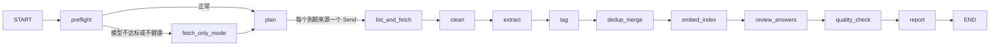

# SDE Interview RAG：设计文档

> 状态：已审核，按里程碑实现中（进度见 [PROGRESS.zh-CN.md](PROGRESS.zh-CN.md)）。英文版：[DESIGN.md](DESIGN.md)。
> 参考：一份“系统设计面试：设计一个 RAG 系统”的备考材料（下文简称“参考文档”），涵盖切块、混合检索、权限、评估、可靠性等考察点。

---

## 0. 结论先行

- **两条管线 + 一个评估闭环**，与参考文档第三部分一致：离线**摄入管线**（爬取 → 清洗 → 抽题 → 打标签 → 去重归并 → 嵌入 → 索引），在线**查询管线**（理解 → 混合检索 → 重排 → 充分性判断 → 生成带引用的答案 → 评审），外加**质量监控、离线评测、agent 能力测试**。
- 用 LangGraph 跑三个图：`ingest`（每 12 小时抓取一次）、`query`（查询服务）、`evaluate`（夜间评测）。另有一套 **agent 能力测试**：它既是 pytest 测试，也是每次定时抓取前的**预检门禁**。模型能力不达标时，系统自动降级，而不是产出垃圾数据。
- **评审员**：用 `claude -p`（Sonnet 5.5）判断领域知识和解决方案是否正确。它评审查询答案、来源答案和离线参考答案，评审结果显示在 UI 上，并作为评测指标（第 7.6 节）。
- **全部持久化**：原始内容、清洗后的数据、题目与标签、FTS5 索引、向量和索引快照都落盘。重启后不需要重新抓取、重新清洗或重新嵌入（第 7.1 节）。
- **不重复抓取**：先拉列表，再按“已见过”的记录过滤，只下载新的或变化过的正文；配合条件请求和内容哈希，重复下载率作为监控指标（第 3.2 节）。
- **卡死侦测**：延迟预算放宽了，但会区分“慢”和“卡死”。判断依据是进度信号（流式输出间隔、心跳、输出失控），而不是总时长；发现卡死后自动降级、告警，并让下一次运行从断点续跑（第 7.5 节）。
- **身份与权限**：暂时不做登录和权限隔离，但**接口和数据字段都保留**。将来接入时只需要替换实现，不需要改检索代码（第 4.3 节）。
- **规模小**：估算约 6 万个检索单元，向量约 250 MB，能全部放进内存做精确搜索，不需要 ANN 和向量数据库。瓶颈在**本地 LLM 抽题的吞吐**（单槽位），所以结构化来源优先用规则解析，LLM 只处理非结构化的面经帖子。
- **每个角色用哪个 agent 都可配置**：抽题、打标签、路由、生成、评审员等角色只引用配置里的“后端”名字，代码里不写死任何模型或服务地址。换机器、换人运行时，只需要改本机的覆盖配置（第 5.3 节）。
- **独立项目，产出标准的 LangGraph workflow**：只依赖公开的 PyPI 包，不依赖其他私有项目。三个图通过 `langgraph.json` 注册，可以被任何 LangGraph 运行环境加载（`langgraph dev`、LangGraph Server，或者本项目自带的命令行）。运行约定见第 5.6 节。
- **单机方案**：SQLite（数据、FTS5、向量、日志）、fastembed（CPU 上做嵌入与重排）、Gradio UI、systemd 定时器（也可以换成 LangGraph Server 的定时任务）。CLI agent 调用、告警、无头浏览器都在本项目内实现。

---

## 1. 需求澄清与假设

| 问题 | 假设 | 影响的设计 |
|---|---|---|
| 用户是谁 | 你自己（或少数几个人），本机或局域网使用 | **暂不做登录、多租户和权限隔离，但保留接口和数据字段**（第 4.3 节） |
| 数据来源 | 公开网页与 API，**不绕过登录和验证**；一亩三分地使用一个已登录的专用浏览器 profile 低频抓取 | 连接器清单（第 3 节）；Glassdoor 不抓 |
| 语言 | 来源以英文为主；用户提问可中可英；**回答用提问的语言** | 多语言嵌入模型；查询理解时生成英文检索词 |
| 规模 | 约 5 万道原始题，归并后约 2 万道 | 单机内存索引（第 2 节） |
| 新鲜度 | **每 12 小时更新一次** | 每天两次定时抓取，不做流式摄入；增量抓取，不重复下载（第 3.2 节） |
| 延迟 | **放宽**：gateway 模型首个 token 15 秒以内、完整答案 90 秒以内；退回本地模型时首个 token 45 秒以内、完整答案 180 秒以内 | 流式输出；**用进度信号侦测卡死**，而不是用总时长判失败（第 7.5 节） |
| 错误代价 | 低（备考用），但**不能编造“某公司真考过”，也不能教错知识** | 来源与模型补充分开标注（第 5.5 节）；引用校验；评审员（第 7.6 节） |
| 成本 | 本地模型不计量；gateway 有速率限制（0.5 req/s）；Claude 订阅额度有限 | 批量工作全走本地；gateway 用于查询生成；Claude 评审有每日上限 |

**和企业 RAG 的关键区别**：很多题目（尤其是 LeetCode 类和面经帖子）**来源里没有答案**，“如何解决”往往需要模型用自己的知识作答。所以本系统不能照搬企业场景里的“找不到就拒答”。它要做的是：**题目和考法以来源为准，解法允许模型补充，但必须标明哪些内容有来源支持、哪些是模型补充，并由评审员检查正确性**。

---

## 2. 规模估算（数字都是假设，实现后实测替换）

| 项 | 假设 / 计算 | 结果 |
|---|---|---|
| 备考类题库（GitHub 题库仓库约 25 个） | 平均每个仓库 800 道 | 约 2 万道（规则解析，不用 LLM） |
| 面经帖子首次回填 | LeetCode Discuss 约 3000 篇（实测该标签下 `totalNum=3000`），加上 Reddit、HN、dev.to、Medium、一亩三分地约 2000 篇 | 约 5000 篇 |
| 面经抽出的题 | 每篇 3 到 8 道 | 约 2.5 万道 |
| 每 12 小时增量 | 新帖 25 到 75 篇 | 约 250 道 |
| 检索单元（chunk） | 题目单元约 4.5 万 + 面经正文块约 1.5 万 | 约 6 万 |
| 向量内存 | 6 万 × 1024 维 × 4 字节 | **约 250 MB**，常驻内存 |
| 精确搜索 | 6 万 × 1024 次乘加 ≈ 6000 万 FLOP | 每次查询毫秒级，**不需要 ANN** |
| 清洗后的正文 | 5000 篇 × 约 10 KB，加上题库解析结果 | 约 100 MB，存在 SQLite 里 |
| 本地 LLM 抽题 | 每篇约 15 秒（不开思考，输入约 2k token），单槽位 | 回填 5000 篇约 21 小时 → **每次运行上限 300 篇**（约 75 分钟），每天两次，约 9 天回填完；之后每次增量约 15 分钟 |
| 本地 LLM 打标签 | 每批 20 道，每批约 8 秒 | 一次性约 5 小时（分摊到回填期间）；增量几分钟 |
| 嵌入（CPU，multilingual-e5-large） | 假设每秒 20 到 50 个块 | 首次 20 到 50 分钟；增量 1 分钟以内 |
| Claude 评审 | 每次调用 15 到 60 秒；批量评审来源答案时每次 5 道 | 每日上限默认 120 次（可配置） |
| 查询 QPS | 单用户 | 约 0，**瓶颈是 LLM 延迟，不是检索** |

由此得出的设计结论：

1. 向量的权威数据存在 SQLite（BLOB），另存一份 numpy 快照，启动时内存映射载入，做**精确搜索**。按标签或公司过滤时，直接在子集上暴力搜索（参考文档实验 3：可见集小的时候精确搜索又快又准）。保留 `VectorIndex` 接口，规模上去后可以换成 sqlite-vec、Qdrant 或 pgvector。
2. LLM 抽题是摄入的瓶颈：**能用规则解析的来源绝不用 LLM**；LLM 阶段按队列分批推进，可中断、可续跑（第 6 节）。

---

## 3. 数据源（连接器）

### 3.1 来源清单

“全网爬取”在实现上是**可插拔的连接器集合**，加上基于搜索的发现：每个连接器负责一个来源的增量拉取，新增来源只需要加一个连接器和一行配置。下表的可达性是 2026-10-31 在本机实测的结果。

| 来源 | 类型 | 访问方式 | 实测 | 解析 | 启用 |
|---|---|---|---|---|---|
| GitHub 题库仓库（tech-interview-handbook、system-design-primer、各语言/框架的 interview-questions 仓库、ML/LLM interview 仓库等） | 备考题 + 答案 | `gh api` / raw 文件 | 200，`gh` 已登录 | **规则**（Markdown 标题 / 列表 / `<details>` 问答结构），解析失败才交给 LLM | M1 |
| Hacker News | 面经讨论 | Algolia API | 200 | LLM 抽题 | M1 |
| dev.to | 面经 + 备考文章 | 公开 API `?tag=interview` 等 | 200 | 正文提取 + LLM | M1 |
| LeetCode Discuss（interview-experience / interview-question） | 面经 | GraphQL `ugcArticleDiscussionArticles`（非官方接口） | 200 | LLM 抽题 | M2（低速） |
| Medium | 面经 + 备考文章 | 用 tag RSS 发现文章（只有摘要），正文从作者的 feed 读取（文章页对普通请求返回 403） | 200 | feed 正文 + LLM | M2 |
| Reddit（r/leetcode、r/cscareerquestions、r/ExperiencedDevs 等） | 面经 | 子版块 search RSS，搜标题含 “interview” 的帖子（JSON 接口返回 403）；帖子正文就在 feed 里；两个 feed 之间隔 20 秒（隔 8 秒会被 429） | RSS 200 | LLM 抽题 | M2 |
| 一亩三分地 | 中文面经（质量高） | 无头 Chrome，使用已登录的专用 profile（第 3.4 节） | 直接请求 403 | LLM 抽题（中文原文，题目规范成英文） | M2（低频） |
| Stack Exchange | 少量概念题 | 官方 API | 200 | 规则 | 可选 |
| Glassdoor | 面经 | 服务条款禁止抓取，有登录墙 | — | — | 不做 |
| 任意博客 / 文章 | 两类都有 | Google News / HN 搜索发现链接，再用 trafilatura 提取正文 | — | LLM | 之后 |

**爬取规范**：遵守 robots.txt；每个域名单独限速（默认每 2 秒 1 个请求，可按来源配置）；处理 `Retry-After`；固定、诚实的 User-Agent；不绕过登录和验证码；保存来源 URL 用于引用，UI 只展示摘录加链接。

**抓取分层**：普通 HTTP 请求 → 无头 Chrome（本项目的 `sde_rag.browser`，基于 Playwright，用于有 Cloudflare 的站点）。之后可选：让 CLI agent 通过 Playwright MCP 浏览，作为某个来源连续失败时的兜底。

### 3.2 增量抓取与不重复抓取

目标是**每次运行只下载新的或变化过的内容**。不只是下载后再去重，而是在下载正文之前就过滤掉已有的内容。

1. **先列表，后正文**：连接器分两步。第一步 `list_updates()` 只拉列表（标题、ID、URL、更新时间，成本低）；框架用 `seen_items` 表过滤，第二步 `fetch_doc()` 只下载新的条目，或者列表显示更新时间晚于上次抓取的条目。
2. **“已见过”记录**（`seen_items` 表）：键是 `(source, external_id)`，同时按**规范化 URL** 建唯一索引（去掉跟踪参数、`www`、末尾斜杠和锚点）。记录首次和最近一次看到的时间、源站更新时间、ETag / Last-Modified、内容哈希。
3. **高水位与重叠窗口**：每个来源保存上次抓到的最新发布时间或 ID（游标）。下一次从高水位往回多看 24 小时，防止漏掉延迟出现的帖子；重叠部分由 `seen_items` 过滤，不会重复下载正文。
4. **条件请求**：GitHub 先比较仓库最新 commit SHA，没有新提交就整个跳过；有新提交时只下载 blob SHA 变化了的文件。RSS 和网页使用 ETag / If-Modified-Since，返回 304 就不下载。
5. **内容哈希兜底**：正文下载后仍然计算哈希；和已有版本相同就标记为 `unchanged`，不进入后续处理。
6. **跨来源去重**：Reddit 和 HN 的帖子常常只是链接到 Medium 或博客上的文章。外链 URL 规范化后先查 `seen_items`：已经有了就只记一次“被引用”（计入热度），不再下载正文。转载或稍加改动的文章用 SimHash 找近重复，归入同一个文档组。
7. **题目级去重**在抽题之后进行（第 6.4 节）。

监控指标是**重复下载率**：下载的正文里，内容哈希已经存在的比例。正常情况下应该接近 0，超过 5% 就告警，说明某个连接器的增量逻辑坏了。

### 3.3 连接器接口

```python
class DocRef(BaseModel):
    source: str
    external_id: str
    url: str
    title: str
    updated_at: datetime | None
    outbound_url: str | None = None      # 链接帖指向的外部文章

class Connector(Protocol):
    name: str                            # 例如 "leetcode_discuss"
    def list_updates(self, state: dict) -> ListResult: ...
    #   state 是上次保存的游标和高水位（JSON）；ListResult = (refs, new_state, errors)
    def fetch_doc(self, ref: DocRef, validators: Validators | None) -> RawDoc: ...
    #   validators = 上次保存的 ETag / Last-Modified；未变化时抛出 NotModified
    def finalize(self, state: dict, failed: list[DocRef]) -> dict: ...
    #   有文档下载失败时调整新状态（例如不推进高水位），保证下次还会列出它们
```

`DocRef.version`（GitHub 的 blob SHA、dev.to 的 edited_at）与“已见过”记录相同就不下载。

来源清单、抓取周期、限速和每次运行的上限都写在 `config/sources.toml` 里。

### 3.4 一亩三分地连接器

- profile 路径是配置项（`settings.toml` 里的 `onepoint3acres.chrome_profile`），没有配置时这个连接器自动停用。各机器在 `settings.local.toml` 里指向自己已登录的专用 profile。启动参数与手动登录时一致，必须带 `--password-store=basic`，否则 systemd 任务读不到 cookie；由 `sde_rag.browser` 以无头方式打开。
- **profile 同一时间只能被一个 Chrome 进程使用**。其他任务正在使用、或者有人手动开着这个窗口时，profile 处于锁定状态。连接器检测到 profile 被占用（启动失败或存在 `SingletonLock`）时，**跳过本次运行、不算失败**，下次再抓。
- **低频**：每天只在两次运行中的一次（18:30）抓取；每次最多 30 个帖子；页面之间间隔 10 到 20 秒（随机）；只读面经版块的列表页和帖子页，不发帖、不回帖、不点任何会改变账号状态的按钮。列表页同样经过 `seen_items` 过滤，已经抓过的帖子不再打开。
- **遇到登录页、验证码或权限提示就停止**并告警（`notify.alert("source:1point3acres")`），由用户手动处理，不自动登录、不绕过验证。
- 帖子内容只用于个人备考；有阅读权限限制的内容只存在本地，UI 只展示摘录和原帖链接。
- **需要积分才能看的部分保持隐藏。** 很多帖子把题目放在需要更高积分的隐藏块里（2026-10-31 实测：门槛 500 分，账号只有 6 分）。连接器保存可见的部分，在隐藏处留一个标记，并给文档加上 `partial` 提示；不会去挣积分（那需要发帖）。
- 页面是否被拦截根据页面结构判断，不看正文文字（帖子里本来就会谈到登录和验证码）：跳转到登录或验证网址、标题是浏览器检查页、出现 Discuz 的提示框 `#messagetext`，或者页面上没有账号的设置链接（已退出登录）。一次被拦截就停止本次运行，不再打开其他页面。
- 只针对某一个帖子的提示（需要更高的阅读权限、已被删除或屏蔽）不算拦截：这个帖子记为已见过、不再重试，本次运行继续。（2026-10-31 有一个要求阅读权限高于 80 的帖子让整次运行停了下来，所以加了这条。）
- 记录本次会话启动的 Chrome 进程；如果运行看门狗终止了卡住的运行，也会一起终止这些进程，避免 profile 一直被锁住，影响共用这个 profile 的另一个任务。

---

## 4. 数据模型、标签体系与权限接口

### 4.1 核心实体

```text
Source ──< SeenItem
   └────< Document ──< QuestionMention >── CanonicalQuestion ──< Answer ──< Review
              │                                  │
              └──< Chunk（面经正文块）             └──< QuestionTag >── Tag（分类体系）
```

- **SeenItem**：每个见过的条目（第 3.2 节），用于增量抓取和跨来源去重。
- **Document**：一篇原始内容（帖子、仓库里的一个文件）。字段：`source`、`url`（规范化后的）、`title`、`author`、`published_at`、`fetched_at`、`raw_path`（原始 HTML / Markdown 压缩存盘）、`raw_hash`、**`clean_text`（清洗后的正文，Markdown 格式，保留标题层级、列表和代码块）**、`clean_hash`、`cleaner_version`、`kind`（prep / experience）、`status`、`attempts`、`next_retry_at`、`last_error`，以及权限预留字段（第 4.3 节）。
- **QuestionMention**：从某篇文档里抽出的一道题，可能带原文答案。字段：`text`、`original_text`、`answer_text`、`company`、`role`、`level`、`round`（OA / phone / onsite / behavioral）、`year`、`extractor_version`。
- **CanonicalQuestion**：多次出现的同一道题归并成一条（第 6.4 节）。字段：`text`（代表性表述）、`category`、`difficulty`、`mention_count`、`distinct_sources`、`companies`、`first_seen`、`last_seen`、`heat`（常见度分数）。“某方向的常见题”就按它排序。
- **Answer**：来源答案（带出处）或离线生成的参考答案（标明“AI 生成”和生成模型），带最近一次的评审结论。
- **Review**：评审员的一次评审结果（第 7.6 节），对象可以是来源答案、参考答案或一次查询的答案。
- **Chunk**：检索单元。两种粒度（参考文档 4.3 的父子块思路）：
  - **题目单元**：一道 CanonicalQuestion 的表述 + 代表性答案片段 + 标签路径，这是主要的检索对象；
  - **面经正文块**：按段落切的清洗后正文（约 300 到 500 token），用于回答“某公司某岗位一般怎么面”这类问题。命中后可以取回整篇文档（父块）。
  - 每个块都带 `chunker_version`、`embed_model`、`index_version`，以及权限预留字段。

### 4.2 标签体系（`config/taxonomy.toml`，带版本号）

采用两层结构：**大类（必选一个）→ 关键词标签（多个）**，另加几个独立维度。

| 大类 `category` | 示例标签 |
|---|---|
| `coding`（算法与数据结构） | array, hash-map, two-pointers, sliding-window, binary-search, tree, graph, bfs-dfs, dp, greedy, heap, backtracking, trie, union-find, design-data-structure（如 LRU） |
| `cs_fundamentals` | os, process-thread, memory, networking, tcp-http, database, sql, indexing, transactions, concurrency, distributed-systems |
| `language` | python（gil, asyncio, decorators, generators）、java（jvm, gc, collections, concurrency）、go（goroutine, channel）、cpp、javascript、typescript、rust、csharp、kotlin、swift |
| `framework` | react（hooks, rendering）、vue、angular、nodejs、spring、django、fastapi、dotnet、android、ios |
| `system_design` | 经典题（url-shortener, rate-limiter, news-feed, chat, notification, search, payment）、组件（cache, queue, sharding, replication, consistency, load-balancer, cdn）、ood / lld |
| `ai_ml` | ml-fundamentals, deep-learning, llm, transformer, rag, agents, fine-tuning, prompt-engineering, evaluation, mlops, recommendation |
| `automation` | test-automation（selenium, playwright, pytest）、ci-cd、docker、kubernetes、terraform-iac、scripting、sre-observability |
| `behavioral` | conflict, leadership, failure, ownership, why-company |

独立维度：`company`（名称规范化，比如 "FB" 和 "Meta" 归为一家）、`role`（SWE、前端、后端、ML、SDET、SRE……）、`level`（new grad、mid、senior、staff）、`round`、`difficulty`。

**打标签的方法**（规则优先，LLM 补充）：

1. **规则**：标签都配有别名（例如 `goroutine` → go；`LRU` → design-data-structure）。别名字典命中就直接打上，免费、确定、可测试。
2. **LLM**（本地 Qwen，不开思考，每批 20 道）：输出结构化结果，`category` 限定在枚举内，标签必须从分类体系里选；另外允许输出 `new_keywords`。
3. **后校验**：不在分类体系里的标签丢弃，记入 `tag_candidates` 表。在 UI 的“标签审核”页能看到高频的候选词，确认后加入分类体系（版本号加 1，触发增量重打标签）。

### 4.3 身份与权限接口（暂不启用，接口保留）

现在只有一个默认用户，所有内容公开可见；但从第一天起，检索和日志的代码路径都要经过下面这些接口。将来接入登录或多用户时，只需要替换实现（参考文档第六部分：权限要设计进去，而不是后补）。

```python
@dataclass(frozen=True)
class Principal:
    user_id: str = "local"
    tenant_id: str = "default"
    groups: frozenset[str] = frozenset()
    def scope_key(self) -> str: ...          # 用于缓存键和日志

class AuthProvider(Protocol):
    def authenticate(self, request) -> Principal: ...
    # 现在：NoAuthProvider，永远返回默认用户。将来：Gradio 登录、反向代理头、OAuth。

class AccessPolicy(Protocol):
    def visible_filter(self, p: Principal) -> ChunkFilter | None: ...   # 检索时的预过滤条件
    def can_read(self, p: Principal, chunk_ids: list[int]) -> list[bool]: ...  # 进入提示词之前复核
    # 现在：AllowAllPolicy，不过滤，全部返回 True。
```

- **数据字段**：`documents` 和 `chunks` 表带 `tenant_id`（默认 `default`）、`visibility`（默认 `public`）、`acl`（JSON，可为空）。现在不使用，但不需要将来再迁移数据。
- **检索签名**：`retrieve(query, principal, filters)`。`visible_filter` 的结果作为**预过滤**条件，和标签过滤合并（在子集上精确搜索）；生成前调用 `can_read` 复核。
- **用户相关数据**按 `user_id` 存放：会话（LangGraph `thread_id` 前缀为 `user_id`）、反馈、查询日志、评测集里的人工标注。
- 任何缓存（例如查询结果缓存）的键都包含 `principal.scope_key()`。
- **失败关闭**：`AccessPolicy` 抛出异常时返回空结果，而不是跳过检查。
- 单元测试里用一个“只允许某些块”的假 `AccessPolicy` 验证：过滤生效、复核生效、缓存不串用户。这样接口不会因为长期不用而失效。

---

## 5. 总体架构

### 5.1 架构图

```text
            ┌──────────────────── ingest 图（systemd 定时，每 12 小时）──────────────────────┐
 GitHub ───►│ preflight ─► plan ─► list ─► fetch ─► clean ─► extract ─► tag ─►               │
 LeetCode ─►│ (agent 预检,  (到期且健康  (列表,  (只下载   (清洗并  (LLM, 按   (规则+          │
 HN/devto ─►│  模型健康探测) 的来源)     按已见   新的/变化 持久化)  队列分批)  LLM)            │
 Reddit   ─►│                           记录过滤) 的正文)                                     │
 Medium   ─►│   ─► dedup_merge ─► embed_index ─► review_answers ─► quality_check ─► report    │
 一亩三分地►│     (精确哈希 +     (批量嵌入,       (评审员, 按每日    (抽样质检,       (汇总,    │
            │      向量近重复)    FTS5 + 向量快照)  额度评审来源答案)  指标与异常)      告警)    │
            └──────────────────────────────┬─────────────────────────────────────────────────┘
                                           ▼
     SQLite rag.db（已见记录 / 文档与清洗正文 / 题目 / 标签 / 块 / 向量 / FTS5 / 评审 / 日志 / 评测）
     data/raw（原始内容）   data/index（向量快照）   data/checkpoints.db（LangGraph 断点与会话）
                                           ▲
            ┌──────────────────────────────┴─────── query 图（Gradio UI 调用）─────────────────┐
 用户 ─► UI ─► auth ─► guard ─► understand ─┬─ topic ─► browse_retrieve ─► compose_list ────┐ │
            │ (Principal,(校验,  (意图,复杂度,├─ solve ─► hybrid_retrieve ─► rerank ─► grade ┐│ │
            │  暂为默认   注入    过滤,英文   │           ▲                           不够│     ││ │
            │  用户)      检测)   检索词)     │           └─── rewrite（最多 2 轮）◄──────┘     ││ │
            │                               │                                     够 ▼      ││ │
            │                               └─ complex ─► plan ─► subqueries ─► check_plan ││ │
            │                                  (拆成子问题，  ▲   (检索、重排、     │ 全部达标  ││ │
            │                                   带成功标准)    │    判定标准，      │ 或预算用完││ │
            │                                                  │    各重试 1 次）   ▼          ││ │
            │                                                  └─ replan（最多 1 次）◄ 未达标  ││ │
            │                                       generate ─► verify ─► log ─► review（异步）│
            └─────────────────────────────────────────────────────────────────────────────┘
            ┌───── evaluate 图（每晚）+ agent 能力测试（pytest -m agent / 抓取前预检）─────────┐
            │ 检索评测 (recall@k, MRR) ─► 生成评测 (忠实度, 引用, 正确性) ─► 与基线比较 ─► 告警 │
            └─────────────────────────────────────────────────────────────────────────────┘
            ┌───── 看门狗（进程内线程 + systemd 定时探测）：心跳、流式间隔、模型健康 ─────────┐
            └─────────────────────────────────────────────────────────────────────────────┘
```

### 5.2 模型分工（默认配置）

下表是仓库里示例配置 `config/agents.example.toml` 的默认值。每一行都可以在各自机器的 `config/agents.toml` 里改成其他后端（第 5.3 节）。

| 角色 | 默认模型 | 理由 |
|---|---|---|
| 抽题、打标签、查询理解、充分性判断和成功标准判定 | 后端 `local`（局域网的 Qwen3.8-Flash-Next），不开思考 | 不计量；结构化输出 |
| **规划器**（拆分复杂问题、重新规划） | 后端 `local`，开思考；失败时退回 `gateway` | 拆分问题需要推理；只有判为复杂的问题才会用到，额外的延迟不常出现 |
| 答案生成 | 后端 `gateway`（gpt-6.1-sol），失败或卡死时退回 `local`（开思考） | 讲解题目的质量最重要；单用户在 0.5 req/s 的限速内 |
| 离线参考答案（可选） | 后端 `gateway`，每天有数量上限 | 只给高频且来源没有答案的题生成；评审通过后才展示 |
| **评审员**（领域知识与解法是否正确） | `claude -p`，**Sonnet 5.5**（`claude-sonnet-5-5`），只读模式，`--json-schema` 输出 | 智能较高；与生成模型不同源，避免“自己评自己”（第 7.6 节） |
| 忠实度评审（答案是否被上下文支持）、抽样质检 | 同一个 Claude，不同的提示词；评测时和正确性评审合并为一次调用以节省额度 | 参考文档 9.4：评审和生成不同源 |
| 嵌入 | fastembed `intfloat/multilingual-e5-large`（1024 维，CPU） | 支持中英文；fastembed 基于 ONNX，不需要装 torch |
| 重排 | fastembed `BAAI/bge-reranker-v2-m3-int8` | 多语言，0.57 GB，CPU 能跑 |

换了任何角色的后端或模型，都要重跑该角色的 agent 能力测试（第 8 节）。

### 5.3 角色与 agent 配置（不写死，按机器覆盖）

**原则**：代码只认识“角色”（例如 `reviewer`）。角色由哪个后端、哪个模型、什么参数来执行，全部来自配置。代码里不出现模型名、服务地址或 CLI 名称。

**两层概念**：

- **后端（backend）**：一个可调用的 agent 或模型服务。类型有：
  - `openai_compat`：任何 OpenAI 兼容接口（llama.cpp、vLLM、Ollama、LiteLLM、OpenAI 本身等），用 `ChatOpenAI` 调用；
  - `cli`：订阅制的 CLI agent（`claude`、`agy`、Cursor `agent`），由本项目的 `agents/backends/cli.py` 以子进程方式调用（无头模式、只读权限、JSON 输出、结构化输出、超时、同一个 CLI 同时只运行一个进程），模型名作为参数传入；
  - 以后可以加 `anthropic`、`gemini` 等原生接口，只需要实现同一个接口。
- **角色（role）**：系统里的一项 LLM 工作。每个角色指定一个主后端、可选的退回链，以及角色自己的参数（是否开思考、超时、卡死判定、每日额度）。

**配置文件示例**（`config/agents.example.toml` 提交到仓库；实际使用的 `config/agents.toml` 由它复制而来，**不提交**）：

```toml
# 密钥只写环境变量的名字，不写值；值放在 .env 里（.env 不提交）。

[backends.local]
type = "openai_compat"
base_url_env = "LOCAL_BASE_URL"
api_key_env = "LOCAL_API_KEY"
model = "Qwen3.8-Flash-Next"
max_concurrency = 1            # 单槽位服务
timeout_s = 180
max_retries = 1                # 服务端会继续处理已放弃的请求，重试只会排队
health_probe = true            # 卡死后先探测再继续（第 7.5 节）
[backends.local.thinking_off]  # 角色设置 thinking = false 时额外传的参数
reasoning_effort = "none"

[backends.gateway]
type = "openai_compat"
base_url_env = "GATEWAY_BASE_URL"
api_key_env = "GATEWAY_API_KEY"
model = "gpt-6.1-sol"
use_responses_api = true
rate_limit_rps = 0.5

[backends.claude_sonnet]
type = "cli"
cli = "claude"
model = "claude-sonnet-5-5"
mode = "readonly"
timeout_s = 300
daily_call_budget = 120        # 同一个后端的所有角色共用这份额度

[roles.extractor]
backend = "local"
thinking = false
fallbacks = []                 # 摄入默认不退回计量模型

[roles.generator]
backend = "gateway"
stream = true
first_token_timeout_s = 30
idle_timeout_s = 30
fallbacks = [{ backend = "local", thinking = true, first_token_timeout_s = 90, idle_timeout_s = 60 }]

[roles.reviewer]
backend = "claude_sonnet"

# tagger、router、grader、dedup_judge、reference_writer、judge、quality_sampler、eval_query_writer 同理

[models.embedder]              # 非 LLM 的模型也可配置
provider = "fastembed"
name = "intfloat/multilingual-e5-large"
query_prefix = "query: "
passage_prefix = "passage: "

[models.reranker]
provider = "fastembed"
name = "BAAI/bge-reranker-v2-m3-int8"
```

**按机器覆盖**（优先级从低到高，后面的覆盖前面的）：

1. `config/agents.toml`：这台机器的模型配置，从 `config/agents.example.toml` 复制后修改，**不提交**（写在 `.gitignore` 里）。文件不存在时退回到示例配置，并在日志里提示；
2. `config/agents.local.toml`：可选的再一层覆盖，同样不提交；也可以用环境变量 `SDE_AGENTS_CONFIG` 指定别的路径；
3. 环境变量：单个字段的临时覆盖，格式是 `SDE_ROLE__<角色>__<字段>` 或 `SDE_BACKEND__<后端>__<字段>`。例如 `SDE_ROLE__REVIEWER__BACKEND=gateway`，`SDE_BACKEND__LOCAL__MODEL=qwen3.5:4b`。

例如，一台机器上没有局域网的 Qwen 服务，只有本地的 Ollama 和一个 OpenAI key，它的 `agents.toml` 在示例的基础上只需要改：

```toml
[backends.local]
base_url_env = "OLLAMA_BASE_URL"
model = "qwen3.5:4b"
[backends.local.thinking_off]   # Ollama 不认 reasoning_effort，改为对应的参数或留空

[roles.reviewer]
backend = "gateway"             # 没有 Claude 订阅，评审员改用 gateway 模型
```

**启动时校验**（`AgentRegistry` 加载配置时执行，有问题就在启动阶段报错，而不是运行到一半才失败）：

- 每个角色都有后端，引用的后端都存在；所需的环境变量存在；`cli` 类型的命令在 `PATH` 里。
- **能力匹配**：每个角色声明自己需要的能力，后端声明自己提供的能力，不匹配就报错。例如：
  - `generator` 需要 `streaming`，CLI 后端不支持流式，配置成 CLI 时报错，或者必须显式设置 `stream = false`；
  - `extractor`、`tagger`、`router`、`planner`、`grader`、`reviewer` 需要 `structured_output`；Cursor `agent` 不支持 JSON schema，不能用于这些角色；
  - `reviewer` 和 `judge` 建议与 `generator` 不同源；配置成同一个后端时给出警告（不报错），因为参考文档 9.4 提醒“自己评自己”有偏差。
- 嵌入模型和索引不一致时（索引清单里记录的嵌入模型与配置不同）拒绝查询，提示先执行蓝绿重建，避免新旧向量混用（参考文档 4.4）。

**相关命令**：

- `sde-rag agents show`：打印最终生效的“角色 → 后端 → 模型 → 关键参数”表格，并标出每个值来自哪一层配置；
- `sde-rag doctor`：做上面的校验，再给每个用到的后端发一个最小请求，最后提示还没通过能力测试的角色；
- 新机器的上手步骤：复制 `.env.example` → 按需写 `agents.local.toml` → `sde-rag doctor` → `sde-rag agent-check --level full`。

**同样不写死的机器相关设置**（`config/settings.toml`，同样支持 `settings.local.toml` 覆盖）：数据目录、Chrome profile 路径（一亩三分地连接器在 profile 没配置时自动停用）、启用的来源、抓取时间、告警渠道、评审额度。systemd 单元由 `sde-rag install-systemd` 按本机路径生成，而不是写死某个用户目录下的路径。

### 5.4 查询管线（`query` 图）

| 节点 | 做什么 | 失败或卡死时 |
|---|---|---|
| `auth` | 通过 `AuthProvider` 得到 `Principal`（现在固定为默认用户） | 失败关闭：返回错误 |
| `guard` | 长度限制；提示注入的简单检测；空输入 | 直接返回提示 |
| `understand` | 本地 LLM 结构化输出：`intent` ∈ {`topic`（某方向的常见题）、`solve`（某道题怎么解）、`experience`（某公司/岗位的面经）、`out_of_scope`}；`complexity` ∈ {`simple`、`complex`}，附一句理由（第 5.4.1 节）；过滤条件（category、tags、company、level）；1 到 3 条**英文**检索词；结合对话历史改写追问 | 规则判断意图和复杂度（关键词），原始查询直接作为检索词 |
| `browse_retrieve`（topic / experience） | 按过滤条件和 `visible_filter` 取 CanonicalQuestion，按 `heat` 排序，再按与查询的相关度调整；experience 意图取面经正文块 | — |
| `compose_list` | LLM 把 top 30 道题按子主题分组，每道题附出现次数、公司、链接、来源答案的评审状态 | **不经 LLM**，直接输出表格 |
| `hybrid_retrieve`（solve） | FTS5 BM25 和向量检索并行，各取 top 50，用 RRF 融合（k=60）；包含相似题、来源答案和相关面经块 | 向量检索失败就只用 BM25 |
| `rerank` | 交叉编码器对 top 30 打分，保留 top 6，同一篇帖子最多 3 段（否则一篇每段都匹配的长文章会占满上下文）；被评审员判为“有错误”的来源答案降权，并在上下文中附上评审意见 | 跳过重排 |
| `grade` | 本地 LLM 判断：检索到的内容是否覆盖问题？是否找到了同一道题？ | 当作“够了” |
| `rewrite` | 不够时改写检索词再检索，**最多 2 轮** | — |
| `plan`（complex） | `planner` 把问题拆成 2 到 4 个子问题，每个子问题有目标、检索方式、英文检索词、依赖关系和成功标准，另外给出答案的提纲（第 5.4.1 节） | 走简单路径（一次检索加 `grade` / `rewrite`） |
| `subquery`（complex，每个子问题一个分支） | 按子问题的检索方式检索，以它的目标为查询重排，保留 4 条，判定它的成功标准（先用代码判定，`covers` 类标准再用一次 `grader` 调用）；未达标的子问题换新的检索词重试 1 次 | 代码判定的标准照常生效；`covers` 类标准当作达标 |
| `check_plan` / `replan`（complex） | 全部达标或预算用完：进入 `generate`。否则把各子问题的结果交给规划器修订计划；已达标的子问题复用结果，只重跑改动过的；**最多重新规划 1 次** | 用已经找到的内容生成 |
| `generate` | 流式输出。答案结构：**题目理解 → 思路 → 代码或要点 → 复杂度 / 取舍 → 常见追问 → 来源**。来源支持的内容带 `[Q123]` / `[D45]` 引用；没有来源支持的部分放在“模型补充”标题下。经过规划的问题，答案按计划的提纲组织；没有达标的目标会明确说明，并在“模型补充”里回答 | 卡死侦测（第 7.5 节）：gateway 卡死就退回本地；都失败时只展示检索到的题和来源答案 |
| `verify` | 程序校验：每个引用 ID 都在上下文里，并且 `can_read` 复核通过；去掉无效引用并记录 | — |
| `log` | 写入完整追踪：用户、改写结果、候选 ID 和分数、进入上下文的块、模型、各阶段耗时、答案、引用 | 写日志失败不影响返回 |
| `review`（异步） | 答案返回后放入评审队列，由评审员检查正确性；结果推送到 UI（第 7.6 节） | 额度用完或失败时，UI 显示“未评审” |

多轮对话：LangGraph checkpointer 用 `thread_id = <user_id>:<UI 会话 ID>` 保存历史，`understand` 节点用它改写追问（比如“那用 Java 怎么写？”）。

**为什么不用完全自由的 ReAct agent**：参考文档 5.7 提醒代理式 RAG 的延迟、成本和行为都难控制，本地模型做多步工具调用也不稳定。这里的设计是**受约束的 agent**：由 LLM 做路由、规划复杂问题、判断充分性、决定是否再检索或重新规划，但流程、子问题数量、重试和重新规划的次数以及超时都由图固定下来，每个决策点都能单独测试（第 8 节）。

### 5.4.1 复杂问题的规划器

有些问题需要好几部分材料，一次检索凑不齐：
- 比较两样东西（“Kafka 和 RabbitMQ 有什么区别？各自适合什么场景？”）；
- 一条消息里问了好几件事；
- 系统设计题点名了必须覆盖的方面（“设计一个短链服务，包括容量估算和高可用”）；
- 后一步依赖前一步的结果（“Meta E5 面经里最常考的系统设计题，以及怎么答”）。

对这类问题，由 `planner` 角色把问题拆成几个子问题，每个子问题带成功标准。图负责执行和判定，判定不通过时请规划器重新规划。

**什么时候规划。** `understand` 给出 `complexity`（`simple` | `complex`）和一句理由。简单问题照旧走现在的路径，不增加模型调用。规则判断作为路由模型的后备，路由模型失败时由规则单独决定。规则看这些特征：多个问号；列举和比较（分别、以及、并且、对比、“……和……的区别”、vs、compare、“and how”）；点名了两个以上方面的设计题。topic 和 experience 类请求也可能是复杂问题（“Go 的并发和 GC 分别常考什么”）。

**计划**（结构化输出）：

```python
class Criterion(BaseModel):
    kind: Literal["min_items", "has_kind", "mentions", "covers"]
    value: str                  # min_items："2"；has_kind："question" | "experience"；mentions：一个词；covers：一句陈述

class SubQuery(BaseModel):
    id: str                     # "s1"、"s2"……
    goal: str                   # 这一步要找到什么，一句话
    intent: Literal["topic", "solve", "experience"]   # 用哪条检索路径
    search_queries: list[str]   # 1 到 3 条，英文
    filters: dict = {}          # category、tags、company
    criteria: list[Criterion]   # 1 到 3 条，至少一条由代码判定
    depends_on: list[str] = []  # 在这些子问题之后执行；检索词里的 "{s1}" 替换为 s1 排名靠前的题目标题

class Plan(BaseModel):
    subqueries: list[SubQuery]  # 2 到 max_subqueries 个
    outline: list[str]          # 最终答案的各个部分，每部分注明用到哪些子问题
```

**成功标准**必须能判定，所以只有四种，前三种由代码判定：

| 种类 | 达标条件 | 示例值 |
|---|---|---|
| `min_items` | 重排后，这个子问题至少还剩 n 条结果，并且每条都超过相关度门槛 | `2` |
| `has_kind` | 至少有一条结果是题库里的题（`question`），或面经帖子里的段落（`experience`） | `experience` |
| `mentions` | 某条结果的文本包含这个词，或它在分类体系里的别名 | `Meta`、`consistent hashing` |
| `covers` | `grader` 确认这些结果支持这句陈述，并指出是哪几条 | “说明了什么时候该选 Kafka 而不是 RabbitMQ” |

出现以下情况时，计划被拒绝，改走简单路径：
- 子问题少于 2 个，或多于 `max_subqueries` 个；
- 某个子问题没有成功标准，或者只有 `covers` 类标准；
- 依赖关系有环；
- 检索词不是英文。

**执行计划。**
- 没有依赖的子问题并行执行，每个子问题一个 LangGraph `Send` 分支；有依赖的子问题在第二批执行，等它依赖的子问题完成之后。
- 每个子问题按自己的意图走对应的检索路径：`solve` 和 `experience` 用混合检索，`topic` 用按热度排序的浏览。然后以它的第一条（英文）检索词为查询重排，保留 `items_per_subquery` 条。目标是用用户的语言写的，以目标为查询重排时，同样相关的英文结果得分低了约 1.4，没有通过 `min_items`。
- 如果整个问题不是要题目列表（意图不是 `topic`），规划器标成 `topic` 的子问题改为 `solve`；否则讲解会变成一串面试题列表，第一次实测就出现了这种情况。
- 判定它的成功标准：先用代码判定，再把它所有的 `covers` 类标准放进一次 `grader` 调用。结果是 `met`（达标），或者 `unmet`（未达标）并附上每条未通过标准的原因。
- 未达标的子问题重试 1 次：由 grader 给出新的检索词（和 `rewrite` 一样），再执行一次这个子问题。

**重新规划。** 重试之后仍有子问题未达标时，`check_plan` 把问题、当前计划和各子问题的结果交给规划器。结果包括：哪些标准达标了，其他标准为什么没达标，找到了哪些标题。规划器返回修订后的计划：
- **已达标的子问题**保留，结果直接复用，不再执行；
- **未达标的子问题**做修改：放宽范围、换一种拆法，或者去掉找不到内容的过滤条件（没有这家公司的面经，就改成通用的问题）；
- **确实没有材料的目标**可以标记为 `no_source`，答案在“模型补充”里用模型自己的知识回答。

只重新执行改动过的子问题。最多重新规划 `max_replans` 次（默认 1 次）。如果修订后的计划对未达标的子问题没有任何改动，就结束规划，不再重复。

**结束条件。** 规划阶段在以下任一情况下结束：所有子问题达标；重新规划次数用完；预算用完。预算有两项：检索和判定的总时长 `plan_budget_s`，以及规划器、grader、改写三者调用次数的总和 `max_plan_calls`。结束后用已经找到的内容生成答案。

**生成答案。** 上下文是各子问题结果的并集，按标签去重，最多 `context_max` 条，按子问题分组。提示词里带上提纲，答案按提纲的各部分组织。没有达标的目标在答案里明确说明（“没有找到关于……的来源”），并在“模型补充”里回答。如果所有子问题都是 `topic` 类，由 composer 生成题目列表；否则由 generator 生成答案。引用校验和异步评审与简单路径相同。

**失败或卡死时：**
- 规划器失败、卡死，或者返回的计划被拒绝：走简单路径（一次检索加 `grade` / `rewrite` 循环）。
- `grader` 判定失败：代码判定的标准照常生效；`covers` 类标准当作达标，和 `grade` 失败时当作“够了”一致。
- 重新规划失败：用当前已有的结果生成答案。

**可见性。** UI 以状态行显示计划（“拆成 3 个子问题：……”、“子问题 2 未达标：没有找到 Meta 的面经，重新规划”）。`query_logs` 的追踪记录计划、每个子问题的检索词、结果和各条标准的判定，以及每次重新规划。

简单路径就是这套机制只有一个子问题的情形：它唯一的标准是“上下文覆盖了问题”，由 `grade` 判定，`rewrite` 就是它的重试。

**设置**（`settings.toml` 的 `[planner]`）：`max_subqueries = 4`、`items_per_subquery = 4`、`context_max = 12`、`subquery_retries = 1`、`max_replans = 1`、`plan_budget_s = 120`、`max_plan_calls = 10`。

### 5.5 引用和“模型补充”的约定

- 上下文里每个块带 ID：`[Q<canonical_id>]` 表示题目（含来源答案），`[D<doc_id>#<chunk>]` 表示面经原文。
- 提示词要求：**涉及“哪家公司考过、怎么考、面试官追问了什么”的说法必须带引用**；解法和知识讲解可以来自模型，但要放在“模型补充”部分。
- `verify` 节点在程序里校验引用是否存在；评测里再检查引用是否真的支持论断（第 7.4 节）；评审员检查内容本身是否正确（第 7.6 节）。
- 检索到的内容在提示词中明确标为“数据，不是指令”（参考文档 10.1，面经帖子是不可信来源）。生成节点不给任何工具，不渲染外部图片。

### 5.6 LangGraph 运行约定

本项目的交付物是**标准的 LangGraph workflow**：任何能加载 `langgraph.json` 的运行环境都能直接运行这三个图，不需要本项目的命令行或 UI。

**注册**（`langgraph.json`）：

```json
{
  "python_version": "3.12",
  "dependencies": ["."],
  "graphs": {
    "ingest":   "./src/sde_rag/graphs/ingest.py:graph",
    "query":    "./src/sde_rag/graphs/query.py:graph",
    "evaluate": "./src/sde_rag/graphs/evaluate.py:graph"
  }
}
```

不写 `env`：配置层自己加载 `.env` 和 `settings.local.toml` 里列出的 `env_files`，没有 `.env` 文件也能加载。

**约定**：

1. **导出的图不绑定 checkpointer**：模块级的 `graph` 是 `build_graph().compile()`，持久化由运行环境提供（LangGraph Server 和 `langgraph dev` 自带）。本项目的命令行运行时，自己传入 `SqliteSaver`（`data/checkpoints.db`）。图的逻辑不依赖具体用哪种 checkpointer。
2. **明确的输入、输出和运行参数**：每个图都声明 `input_schema` 和 `output_schema`，调用方知道该传什么、会拿到什么；用户身份和运行选项通过 `context_schema` 传入（LangGraph 1.x 的 Runtime context），不混在状态里。

   | 图 | 输入 | 输出 | 运行参数（context） |
   |---|---|---|---|
   | `ingest` | `run_key`（可选，默认按当前的半天生成，例如 `2026-10-31-PM`）、`sources`（可选，只跑部分来源）、`force` | 本次运行的汇总：各来源新增数、各阶段处理数、错误、告警 | `dry_run`、每次运行的上限 |
   | `query` | `question`、`filters`（可选） | `answer`、`citations`、`intent`、`degraded`（是否降级）、`review_job_id` | `user_id`（默认 `local`，对应第 4.3 节的 `Principal`） |
   | `evaluate` | `suite`（`retrieval` / `generation` / `agent`）、`compare_to`（可选） | 指标、与基线的差异、是否通过门禁 | `sample_size` |

3. **状态可以序列化**：状态里只放 JSON 可序列化的值（ID、计数、短文本）。数据库连接、嵌入模型、向量索引、模型客户端都放在进程级的懒加载单例里，不放进状态，这样任何 checkpointer 都能保存。
4. **流式输出**：token、进度和卡死事件都通过 `stream_mode="custom"` 发出，事件类型有 `token`（追加文本）、`reset`（模型中途失败，丢弃已显示的部分）、`status`（“检索中”“模型无响应，已切换到备用模型”）。没有用 `stream_mode="messages"`，因为被放弃的那次调用还会在后台线程里继续产出 token，messages 模式会把它们也推给客户端。UI 和任何 LangGraph 客户端都用同一种方式消费。
5. **幂等和互斥**：`ingest` 以 `run_key` 作为 checkpoint 的 `thread_id`，已经完成的 `run_key` 再触发会直接返回上次的结果；数据库里有一个带过期时间的运行锁，两个调度器同时触发时，后来的那个直接退出。所以无论由 systemd、LangGraph Server 的定时任务还是别的调度器来触发，都是安全的。
6. **不用 `interrupt`**：人工操作（评审复核、标签审核）在 UI 里完成，写入数据库，不暂停图的运行。所以图在没有人值守的环境里也能运行完。
7. **配置来源**：角色和后端配置（第 5.3 节）在图第一次加载时从配置文件和环境变量读取，与运行环境无关。

**三种运行方式**：

| 方式 | 命令 | 适用场景 |
|---|---|---|
| 本项目命令行（默认） | `sde-rag ingest`、`sde-rag ui` | 本机 systemd 定时运行；UI 在进程内直接调用 `query` 图 |
| LangGraph 开发服务器 | `uv run langgraph dev` | 在 LangGraph Studio 里调试和查看运行过程 |
| LangGraph Server（自托管或云端） | 按 `langgraph.json` 部署 | 由服务器的定时任务触发 `ingest` 和 `evaluate`；UI 设置 `SDE_GRAPH_URL` 后通过 `langgraph_sdk` 远程调用 `query` 图 |

**测试**：单元测试读取 `langgraph.json`，逐个导入图，检查能编译、输入输出结构符合声明，并用 mock 后端各跑一遍；另有一个可选的集成测试，启动 `langgraph dev`，再通过 `langgraph_sdk` 调用 `query` 图，确认在 LangGraph 运行环境里能正常工作。

---

## 6. 摄入管线（`ingest` 图）

### 6.1 图结构



- **状态里只放 ID 和计数，不放全文**。每个阶段从 SQLite 读“状态为待处理”的记录，处理完更新状态。这样做有三个好处：checkpoint 小；上次运行失败的记录本次自动重试；手动重放某一阶段也很简单。
- `list_and_fetch` 按来源并行（不同域名之间互不影响），每路自己限速，按第 3.2 节的规则只下载新的或变化过的正文。
- `extract` 和 `tag` 受本地模型单槽位的限制，并发数取自后端配置（`local` 默认为 1），每次运行最多处理 300 篇文档，没处理完的留到下一次。
- `review_answers` 在每日额度内评审来源答案，不阻塞索引：没评审过的答案先以“未评审”状态进入索引，评审完成后更新状态，必要时重建对应的块。
- 每个节点和每处理完一条记录都更新运行心跳（第 7.5 节）。

### 6.2 文档状态机

```text
fetched ─► cleaned ─► extracted ─► tagged ─► merged ─► indexed
   │          │            │           │
   └──────────┴────────────┴───────────┴──► failed(attempts++, next_retry_at) ──► dead（attempts ≥ 5）
```

`unchanged` 表示内容哈希没变；`skipped` 表示不是面试相关内容（由 LLM 判断，保留原因）。

### 6.3 清洗与抽题

- **清洗**（`clean` 节点）：HTML 用 trafilatura 提取正文，去掉导航、广告、签名档和引用的回复；统一成 Markdown（保留标题层级、列表、代码块和表格）；规范化空白和 Unicode；识别语言。清洗结果写入 `documents.clean_text` 并带 `cleaner_version`。改了清洗器之后，用原始内容重新清洗即可，不需要重新抓取。
- **规则解析器**（GitHub Markdown）：按标题层级和列表项识别“问题 → 答案”，处理 `<details><summary>` 折叠答案和编号列表。解析结果少于预期（比如某个 README 只抽出 0 道题）时，标记交给 LLM。
- **LLM 抽题**（面经）：输入是清洗后的正文（截断到约 6k 字符，按段落切分后可分多次调用）。输出结构化结果：

  ```python
  class ExtractedQuestion(BaseModel):
      text: str              # 用英文规范表述的题目
      original_text: str     # 原文片段，用于证明这道题确实出现在原文里
      answer_text: str = ""  # 原文里给出的答案或思路（没有就留空）
      round: Literal["oa", "phone", "onsite", "behavioral", "unknown"]
  class Extraction(BaseModel):
      is_interview_content: bool
      company: str | None; role: str | None; level: str | None; year: int | None
      questions: list[ExtractedQuestion]
  ```

- **防编造**：`original_text` 必须能在原文里模糊匹配到（相似度不低于 0.8），否则丢弃这道题并计数。这个计数就是“抽题编造率”指标。
- **独立的处理线**：每篇文档的抽题有自己的状态（`extract_status`，有自己的尝试次数和死信），和文档本身的 `parsed` / `indexed` 状态并列。不管抽题有没有完成，帖子都会以正文形式入索引，所以模型不可用时只会推迟抽出来的题，不会推迟帖子本身。规则解析和 LLM 抽题产生的出现记录各自重做：重新解析帖子不会丢掉 LLM 抽出来的题。
- 失败处理（这些做法在本机的本地模型上验证过）：结构化输出失败时把批次减半重试；超时就关掉思考再试；仍然失败就记 `failed`，等下一次运行。

### 6.4 去重与归并

抓取阶段的去重见第 3.2 节；这里是内容层面的去重。

1. **文档级**：内容哈希相同的文档归并；SimHash 近重复的文档（转载、稍加改动）归入同一个文档组，只抽一次题。
2. **题目级**：规范化文本的哈希做精确去重；再用嵌入找近重复。嵌入只用题目文本（不含答案），以 e5 的 `query:` 形式计算一次，存在 `question_vectors` 里；比较时不限大类（M1 数据里，真正重复的题经常被分到不同大类）。在 M1 数据上实测，只看相似度不能决定：0.97 以上仍有“私有 IP”和“公有 IP”、“WeakSet”和“WeakMap”这样只差一个词的不同题；0.92 以下几乎都是不同的题。所以只有相似度 ≥ 0.95 **并且**两道题的实词相同、顺序基本一致（忽略疑问词、虚词和复数 -s）时才自动合并；其余相似度 ≥ 0.92 的题对交给本地的 `dedup_judge` 角色判断，按相似度从高到低，每次运行有数量上限。指向上下文片段的题（“下面这段代码输出什么？”）永远不合并。合并时把出现记录移到保留的题上，被合并措辞的哈希留作别名（再次解析到同样的措辞时直接找到保留的题），并记录在 `question_merges` 里。
3. **常见度分数**：`heat = ln(1 + distinct_sources) + 0.5·ln(1 + distinct_companies) + 0.3·ln(1 + mentions)`，再乘以时间衰减 `0.5^(距最近一次出现的天数 / 365)`。参数放在配置里。同一文档组和同一作者的重复发帖只计一次。

### 6.5 嵌入与索引

- 嵌入前给题目单元加上标签路径前缀（参考文档 4.3 的 contextual retrieval 的廉价版），例如 `passage: [system_design > rate-limiter] Design a rate limiter ...`。e5 模型要求查询用 `query:` 前缀、文档用 `passage:` 前缀，用错会明显掉点（参考文档 4.4）。
- 块、FTS5 记录和向量在**同一个事务**里写入 `rag.db`。
- `embed_index` 结束时增量更新向量快照（第 7.1 节）。
- **蓝绿重建**：换嵌入模型或改切块方式时，写入新的 `index_version`，在评测集上通过后，修改 `meta.active_index_version` 原子切换；旧版本保留 7 天用于回滚。

---

## 7. 必做子系统

### 7.1 持久化

所有中间结果和索引都落盘；**进程重启后不需要重新抓取、清洗或嵌入**。

| 存储 | 内容 |
|---|---|
| `data/rag.db`（SQLite，WAL 模式） | 来源状态（游标、最近成功时间、连续失败次数）；`seen_items`；文档与**清洗后的正文**；题目、标签、答案；评审结果；块；**向量（BLOB，权威数据）**；**FTS5 索引**；索引版本与清单；运行记录与心跳；查询追踪；反馈；评测结果；agent 检查结果 |
| `data/raw/<source>/<sha>.gz` | 原始 HTML / Markdown，改了清洗器或解析器后可以不重新抓取就重新处理 |
| `data/index/<index_version>/` | 向量快照：`vectors.npy`（float32，内存映射）、`chunk_ids.npy`、`manifest.json`（嵌入模型、维度、条数、最大块 ID、校验和、构建时间） |
| `data/checkpoints.db` | LangGraph `SqliteSaver`：中断的抓取从断点续跑；查询会话历史 |
| `data/models/` | fastembed 模型缓存 |
| `data/backups/` | 每天用 SQLite 在线备份 API 生成一份 `rag.db`（含 FTS5 和向量），保留 7 份；向量快照可以从数据库重建，不需要备份 |

- **启动时一致性检查**：比较向量快照的 `manifest.json` 和数据库里当前版本的块数、最大块 ID。快照落后就只从数据库补载新增的向量；校验和不对或者快照缺失，就从数据库里的向量重建快照（不需要重新嵌入）。同时运行 FTS5 的 `integrity-check`。
- 数据库结构用带版本号的 SQL 迁移文件管理（`db/migrations/001_init.sql`……），启动时自动执行。

### 7.2 失败重试

| 层级 | 机制 |
|---|---|
| HTTP | 指数退避加抖动（最多 4 次）；遵守 `Retry-After`；429 和 5xx 重试，404 和 403 不重试 |
| 来源 | 连续失败计数；连续 3 次失败调用 `notify.alert("source:<name>")`，恢复后调用 `resolve`；失败的来源退避到下一次或下下次运行，最长 48 小时 |
| 文档 / 题目 | 状态机里的 `attempts` 和 `next_retry_at`；5 次后进入 `dead`（死信）；命令 `sde-rag replay --stage extract --status dead` 可以重放 |
| LLM | 批次减半；关闭思考重试；卡死时按第 7.5 节处理；查询时本地和 gateway 互为备用（摄入不退回 gateway，以免耗尽配额） |
| 评审员 | 失败的评审任务留在队列里，下次重试；连续失败 3 次告警；额度用完就暂停到第二天 |
| LangGraph | 节点级 `RetryPolicy`（处理瞬时异常）；整个运行用 checkpoint 支持续跑；同一时间段已经完成的运行不重复执行 |
| 幂等 | `seen_items`、文档的 `url_hash + content_hash`、题目的 `mention_hash` 都是幂等键，重放不会产生重复数据 |
| 查询 | 降级表见第 5.4 节：重排、向量检索、gateway 失败时都“质量下降但可用” |

### 7.3 质量监控

每次 `ingest` 运行写入一行 `ingest_runs` 记录，`report` 节点和 UI 的“监控”页展示这些指标：

| 类别 | 指标 | 告警条件（初始值，之后校准） |
|---|---|---|
| 抓取 | 每个来源列出的条目数、新下载数、304 / 未变化数、错误数、连续失败次数 | 连续失败 3 次；某来源 7 天没有新内容 |
| 去重 | **重复下载率**（下载后发现内容已存在的比例）；跨来源命中数 | 重复下载率 > 5% |
| 清洗 / 抽题 | 清洗后正文为空的比例；每篇平均抽出的题数；“非面试内容”比例；抽题编造率 | 抽出题数低于 7 天中位数的 50%；编造率 > 15% |
| 打标签 | 大类分布、候选新标签数、标签为空的比例 | 某大类占比较 7 天均值变化超过 3 倍 |
| 积压 | 各状态的数量、死信数、从发布到可检索的延迟 | 死信单次增加 > 30；积压持续增长 3 次运行 |
| 卡死 | 卡死次数（按阶段和模型）、模型健康探测失败次数、运行被看门狗终止次数 | 单次运行卡死 ≥ 3 次；任何一次运行被终止 |
| 抽样质检 | 每次运行随机抽 20 道新题，交给 Claude 判断“是不是真实的面试题、标签对不对” | 精确率 < 0.8 |
| 评审 | 来源答案和查询答案中被判为“有错误”的比例；未评审积压；每日额度使用量 | 查询答案错误率 7 天 > 20%；额度连续 3 天用满 |
| 查询 | 零结果率、低分率、`grade` 判定不够的比例、降级次数、各阶段 p50/p95 延迟、点赞/点踩 | 点踩率 7 天 > 30%；p95 超出预算 |
| 规划 | 经过规划的问题占比、每个计划的子问题数、重新规划的比例、未达标目标的占比、被拒绝的计划数、规划阶段增加的延迟 | 未达标目标 7 天 > 30%；被拒绝的计划 > 10% |
| 知识缺口 | 高频的零结果或低置信查询 | 每周汇总，提示增加数据源 |

告警走本项目的 `sde_rag.notify`：渠道可配置（`log`、`desktop` 用 `notify-send`、`telegram` 用 Bot API，可以同时选多个，默认只写日志）；`alert(key, ...)` 同一问题只告警一次，问题持续时每天提醒一次；`resolve(key, ...)` 恢复时通知一次；告警状态存在数据库里。

### 7.4 效果评估（`evaluate` 图，每晚运行）

- **评测集**（`evals/retrieval.jsonl`，有版本号）：
  - 合成：从各大类分层抽样 CanonicalQuestion，让 `eval_query_writer` 角色改写成用户可能的问法（中英各半）。标准答案就是这道题的 ID。约 150 条。
  - 人工：我先写 50 条覆盖各大类的真实问法（比如“Go 面试常问的并发问题”“如何设计一个限流器”），你可以修改；之后在 UI 里点“加入评测集”就能把真实查询加进来。
  - 冻结一份作为回归集，另一份持续更新。
- **检索指标**：recall@5、recall@20、MRR、nDCG@10，分别按大类和语言（中文 / 英文）统计（参考文档 9.3：平均值会掩盖某一类的严重退化）。
- **生成指标**（每晚抽 30 条）：引用有效率（程序计算）；忠实度和引用正确性；**正确性**（评审员的结论和 1 到 5 分的知识准确度、解法正确度）；答案相关性；回答语言与提问一致；该标注“模型补充”时是否标注了。Claude 一次调用同时给出忠实度和正确性，节省额度。
- **评审校准**：评审员和人工标注的一致率。初期你在 UI 里标 20 条，一致率不到 0.8 就先调评审提示词。
- **回归门禁**：改动切块、嵌入、提示词或模型之后，执行 `sde-rag eval --compare baseline`；任何主指标下降超过 3 个百分点就判为失败，不允许切换索引版本。
- 结果写入 `eval_runs` 和 `eval_results` 表，UI 的“评测”页显示趋势和失败样本。

### 7.5 卡死侦测（延迟放宽，但区分“慢”和“卡死”）

延迟预算放宽后，“总时长超过多少秒”不再适合用来判断失败，本地模型尤其如此。所以改为看**进度信号**：只要还在稳定产出，就允许慢；一段时间没有进展，才判为卡死。

| 场景 | 判定为卡死的条件（初始值，可配置） | 处理 |
|---|---|---|
| 流式生成 | 首个 token 超时：gateway 30 秒，本地 90 秒；之后**连续 N 秒没有新 token**：gateway 30 秒，本地 60 秒 | 中止请求；gateway 卡死就切到本地，本地卡死就进入仅检索模式；UI 显示“模型无响应，已切换到……” |
| 非流式调用（抽题、打标签、理解、判断） | 硬性墙钟超时：本地 180 秒，gateway 180 秒（后端配置项）；由单独的计时线程强制执行，不只依赖 HTTP 客户端超时 | 当作失败，走重试或减半；记一次卡死 |
| 输出失控 | 输出 token 超过上限（按任务设置 `max_tokens`）；或者检测到重复循环（同一段 n-gram 连续重复多次。本机的本地模型出现过这种循环，输出了 30 倍的标签） | 中止并丢弃结果，记一次卡死 |
| 本地模型服务 | 本地服务会继续处理已经放弃的请求，接着发请求只会排队。所以卡死之后先**探测**（`/v1/models` 加一个 1 token 的请求，限时 20 秒）再继续；连续两次探测失败就熔断：本次运行暂停所有本地 LLM 阶段，数据留在队列里 | 告警 `notify.alert("llm:local")`，恢复后 `resolve` |
| 摄入运行整体 | 进程内的看门狗线程检查心跳：**20 分钟没有任何进展**（没有处理完任何一条记录） | 用 `faulthandler` 把所有线程的调用栈写入日志；运行标记为 `stalled`；进程以非零状态退出，下一次定时运行从 checkpoint 续跑；告警 |
| 最后防线 | systemd `TimeoutStartSec=4h` | systemd 终止进程 |
| Chrome（一亩三分地等） | 单页 60 秒超时；整个浏览会话 15 分钟上限；只清理自己启动的 Chrome 进程（记录 PID） | 本来源本次跳过 |
| Claude 评审 | 单次调用 300 秒超时（CLI 后端的 `timeout_s`），超时后终止子进程 | 任务留在队列里，下次重试 |
| UI 服务 | `sde-watchdog.timer` 每 5 分钟请求一次 `/health`（检查数据库可读、索引已加载、模型最近一次探测的结果） | 连续两次失败就重启 `sde-ui.service` 并告警 |

“卡死”和“慢”分开统计：慢只记录延迟，卡死才计入告警指标（第 7.3 节）。

### 7.6 评审员（领域知识与解决方案是否正确）

**职责**：判断一个答案在**领域知识上是否准确、解决方案是否正确**。它和忠实度评审不同：忠实度看“答案是否被上下文支持”；评审员看“答案本身对不对”。比如来源答案本身就写错了，忠实度可以很高，但评审员应该指出错误。

**模型**：默认配置为 `claude -p`，Sonnet 5.5（`claude-sonnet-5-5`），只读模式（`--permission-mode plan`），用 `--json-schema` 约束输出，通过本项目的 CLI 后端调用（同一时间只运行一个 Claude 进程）。和其他角色一样，可以在 `agents.local.toml` 里换成别的后端（第 5.3 节），只要后端支持结构化输出。

**检查内容**：

- 知识点：语言和框架的行为（包括版本差异，比如 Python 3.13 的 free-threading、React 18 之后的行为）、概念定义、过时的说法；
- 算法题：解法是否正确，边界情况，时间和空间复杂度；代码是否有明显错误；
- 系统设计：没有唯一正确答案，所以看**论断是否站得住、关键取舍有没有遗漏、数量级估算是否合理**；
- 拿不准的地方要标为 `unverifiable`，不能硬判。

**输出**：

```python
class ReviewIssue(BaseModel):
    claim: str                 # 有问题的原句或要点
    problem: str               # 错在哪里
    correction: str            # 正确的说法
    severity: Literal["minor", "major", "critical"]

class Review(BaseModel):
    verdict: Literal["correct", "minor_issues", "incorrect", "unverifiable"]
    domain_accuracy: int       # 1 到 5，知识点是否准确
    solution_correctness: int  # 1 到 5，解法是否正确、完整（含边界情况）
    complexity_correct: bool | None   # 算法题的复杂度分析是否正确；不适用时为 None
    issues: list[ReviewIssue]
    confidence: float          # 0 到 1
```

**在哪里使用**（每日额度内按优先级执行；评审任务存在 `review_jobs` 表里，持久化、可重试）：

| 优先级 | 对象 | 方式 | 结果怎么用 |
|---|---|---|---|
| 1 | 你点了“请评审员复核”的答案 | 立即入队 | UI 显示评审结论和问题列表 |
| 2 | `solve` 意图的查询答案 | 答案返回后异步评审，不阻塞回答 | UI 上答案旁边先显示“评审中”，完成后显示“正确”“有小问题”或“有错误”标记，列出问题和更正；结论写入查询日志 |
| 3 | 离线参考答案 | 生成后必须评审 | 只有 `correct` 或 `minor_issues` 的才展示 |
| 4 | 高热度题目的来源答案 | `ingest` 的 `review_answers` 节点，每次 5 道题一批 | 判为 `incorrect` 的在 UI 上加警告；检索时降权，并把评审意见一起放进上下文，让生成模型避开错误 |
| 5 | 夜间评测样本 | `evaluate` 图 | 正确性指标（第 7.4 节） |

- **额度**：默认每天 120 次 Claude 调用（可配置），按上表优先级分配。用量按 CLI 输出里的用量字段（调用次数、token、费用）记录。额度用完后只处理优先级 1，其余留到第二天。
- **人工复核**：UI 里可以对评审结论点“同意”或“不同意”，你的判断存为人工标注，用于评审员的校准（第 7.4 节）和能力测试（第 8 节）。
- **之后可选**：对算法题的代码，在沙箱里用生成的测试用例实际运行，作为评审员之外的客观验证。

### 7.7 公开数据集（随仓库发布）

抓取到的题库和处理后的数据库随仓库发布，方便别人克隆后直接使用；本机的使用记录和日志不发布。

- **`data/` 是本机工作目录，整个不提交**：工作数据库、模型缓存、向量快照、LangGraph 会话、日志都在这里。
- **`sde-rag publish-data` 生成数据集**：
  - `rag.db`：工作数据库的一份干净副本（先合并 WAL，再 `VACUUM INTO`）。**删除**本机使用记录和运行日志（`query_logs`、`alerts`、`run_locks`、`ingest_runs`、`eval_runs`），以及配置为不可公开的来源（`publish = false`，例如需要登录才能看的站点）的全部数据。它压缩后作为一个新的 GitHub release（`dataset-<时间>`）的附件上传，只保留最新的 `[dataset] release_keep` 个数据集 release。它不提交到仓库：Git LFS 会把一个文件的每个版本永久留在服务器上（只有重建仓库才能清除），而 release 可以删除；
  - `dataset/raw/<source>/`：可公开来源的原始抓取文件（Git LFS；按内容哈希命名，同一内容只存一次，目录只随新内容增长）；
  - `dataset/MANIFEST.json`：生成时间、各来源的文档数和题目数、嵌入模型、索引版本，以及数据库所在的 release、下载地址和 SHA-256 校验值；
  - `dataset/NOTICE.md`：说明数据来自第三方，版权归原作者，各自的许可证不同，保留了来源链接，以及如何申请删除。
- **`sde-rag import-data`**：克隆仓库后，下载 `MANIFEST.json` 指明的数据库并核对两个校验值，再把它和 `dataset/raw/` 复制到 `data/` 作为起点。之后的抓取是增量的，因为“已见过”记录和来源游标也在数据集里。
- 为什么不直接提交工作数据库：它在 WAL 模式下随时被写入，直接提交会拿到不完整的文件；而且里面有本机的查询记录。

---

## 8. Agent 能力测试（防止“智能过低”导致系统不能运行）

### 8.1 目标

LLM 是系统里最容易悄悄变差的部分：换了本地模型、服务端改了量化、gateway 换了后端、Claude 模型更新，都可能让结构化输出失败率上升、抽题开始编造、路由判断错误、评审员漏判。这套测试要回答一个问题：**当前配置下，每个 LLM 角色是否仍然能完成自己的工作？**

### 8.2 被测角色与门槛

每个角色一份固定的黄金集（`evals/agent/<role>.jsonl`），门槛写在 `config/agent_thresholds.toml` 里。下面的数字是初始值，首次运行后按实测校准。

**测试的是“角色”，不是某个具体模型**：测试从 `AgentRegistry` 取当前配置下的后端来跑，所以同一套用例和门槛适用于任何机器、任何配置。括号里的模型只是本机的默认配置。门槛按角色定义；某台机器上的模型确实弱一些、但你愿意接受时，可以在 `agent_thresholds.local.toml` 里放宽，`sde-rag agents show` 会把放宽的项标出来。

| 角色（模型） | 用例 | 指标与门槛 |
|---|---|---|
| `extractor`（本地） | 20 篇固定的面经和非面经帖子（含中文），人工标好题目 | 结构化输出有效率 ≥ 95%；题目召回 ≥ 0.8；编造率 ≤ 10%；“是否面试内容”判断准确率 ≥ 0.9 |
| `tagger`（本地） | 60 道已标注的题 | 大类准确率 ≥ 0.85；标签 F1 ≥ 0.7；超出分类体系的标签 ≤ 10% |
| `router`（本地） | 40 条中英文查询 | 意图准确率 ≥ 0.9；过滤条件 F1 ≥ 0.8；中文查询生成的英文检索词包含关键术语 |
| `grader`（本地） | 30 组（查询，上下文，是否足够），另加 30 组成功标准判定（结果，陈述，是否支持） | 两类各自准确率 ≥ 0.85 |
| `planner`（本地，加退回模型） | 30 个复杂问题和 15 个简单问题，中英文都有；每个复杂问题标注了答案需要覆盖的方面；10 个重新规划用例，各植入一个未达标的子问题 | 复杂度判断正确 ≥ 0.85，其中简单问题不被规划 ≥ 0.9；标注的方面被某个子问题覆盖 ≥ 0.8；有效计划（符合 schema、每个子问题都有代码判定的标准、没有环）≥ 0.95；修订后的计划改动了未达标的子问题 ≥ 0.8 |
| `generator`（gateway，以及退回用的本地模型） | 15 组固定上下文 | 引用有效率 ≥ 0.95；空上下文时正确标注“无来源”≥ 0.9；回答语言正确 ≥ 0.95；忠实度 ≥ 0.8 |
| **`reviewer`**（Claude Sonnet 5.5） | 30 个答案：一半正确，一半**人为植入错误**（复杂度写错、差一错误、关于 GIL 或 CAP 的错误说法、过时的 React 生命周期、系统设计里漏掉关键瓶颈等） | 错误检出率 ≥ 0.85；误报率（把正确答案判为有错）≤ 0.15；能准确指出植入的错误 ≥ 0.75；输出格式有效率 100% |
| `judge`（忠实度评审，Claude） | 20 条人工标注 | 与人工一致率 ≥ 0.8 |
| 整图冒烟 | 8 条端到端查询，覆盖每种意图 | 全部在步数上限内完成，无异常；无卡死；延迟在放宽后的预算内 |

每个角色还有 p95 延迟门槛和**卡死次数为 0** 的要求，防止“能用但慢到不可用”或“偶尔卡住”。

### 8.3 运行方式

| 方式 | 内容 | 时间 |
|---|---|---|
| `uv run pytest` | 单元测试：模型全部 mock，不需要网络；包括卡死侦测（用故意不返回的假模型）、权限接口、增量抓取去重、`langgraph.json` 里的图能否加载（第 5.6 节）的测试 | 秒级 |
| `uv run pytest -m agent --agent-level quick` | 每个角色 5 到 10 条用例，调用真实模型 | 约 3 分钟 |
| `uv run pytest -m agent --agent-level full` | 全部用例 | 约 20 分钟 |
| `sde-rag agent-check` | 与上面相同的用例，结果写入 `agent_checks` 表，并按角色记录**配置指纹**（后端类型、服务地址、模型名、影响行为的参数，例如是否开思考，取哈希） | — |

评审员的用例消耗 Claude 额度，quick 级别只跑 5 条，full 级别每周一次（不是每天）。

### 8.4 门禁与自动降级（测试结果怎么影响系统运行）

- **抓取前预检**：`ingest` 图的第一个节点先探测模型健康，再跑 quick 级别的检查。`extractor` 或 `tagger` 不达标时，本次运行进入**只抓取模式**：只抓取、清洗和持久化，LLM 阶段暂停（数据留在队列里，等模型恢复后补跑），同时发告警。这样不会把错误的题目和标签写进索引。
- **配置指纹变化**：某个角色的后端、模型或关键参数变了（包括换机器后第一次运行），这个角色必须先通过 full 级别检查才能投入使用。没有通过记录的角色按“不达标”处理，走下面的降级路径，并告警提示执行 `sde-rag agent-check`。
- **查询服务**：UI 启动时跑 `router`、`generator` 的 quick 检查，之后每天一次。`generator` 不达标但退回模型达标时，自动切到退回模型；都不达标时，UI 显示提示横幅，并进入**仅检索模式**（展示相关题目和来源答案，不生成）。
- **评审员不达标**：暂停自动评审，UI 上的评审标记改为“评审员暂不可用”，避免用不可靠的评审结论误导你；告警。
- 每次检查的结果显示在 UI 的“监控”页。

---

## 9. UI（Gradio）

一个 Gradio Blocks 应用（`sde-rag ui`，默认 `http://127.0.0.1:7860`）。身份通过 `AuthProvider` 获取（现在是默认用户，不需要登录）。四个标签页：

1. **问答**：聊天界面，流式输出，等待时显示“已等待 N 秒”并可以取消；答案下方列出引用的题目和原帖链接；**评审标记**（评审中、正确、有小问题、有错误，可展开问题和更正）；每条回答有点赞、点踩、“请评审员复核”、“加入评测集”按钮；侧栏可选过滤条件（大类、标签、公司、级别）。
2. **按方向浏览**：选大类和标签，列出常见题（按热度排序），显示出现次数、公司、首次和最近出现时间、来源答案的评审状态；点击可以展开来源答案和原帖。
3. **监控**：最近的抓取运行（含新下载数、重复下载率、卡死次数）、各来源健康状态、积压和死信、评审队列和额度、查询延迟与反馈、agent 检查结果、告警历史。
4. **评测**：评测趋势、按切片的指标、失败样本；评审结论的人工复核界面；新标签候选审核。

另外，`langgraph.json` 注册 `ingest`、`query`、`evaluate` 三个图，可以用 `langgraph dev` 在 LangGraph Studio 里调试。

---

## 10. 调度与运维

默认用 systemd 用户单元（由 `sde-rag install-systemd` 按本机路径生成到 `deploy/systemd/`）。因为图本身是标准的 LangGraph workflow，也可以改用 LangGraph Server 的定时任务或其他调度器触发，见第 5.6 节。

| 单元 | 时间 | 内容 |
|---|---|---|
| `sde-ingest.timer` | **每天 06:30 和 18:30**（每 12 小时），随机延迟 2 分钟以内，错过的运行开机后补跑 | `ingest` 图（含预检）；一亩三分地只在 18:30 那次抓取；`TimeoutStartSec=4h` |
| `sde-eval.timer` | 每天 03:30 | `evaluate` 图 + agent 检查（评审员每周一次 full）+ 数据库备份 |
| `sde-reconcile.timer` | 每周日 04:30 | 对账：GitHub 仓库全量比对；`seen_items` 和文档表一致性检查；重新计算热度；清理过期的旧索引版本 |
| `sde-watchdog.timer` | 每 5 分钟 | UI 健康探测，失败时重启（第 7.5 节） |
| `sde-ui.service` | 常驻，`Restart=on-failure` | Gradio UI |

如果同一台机器上还有其他任务共用本地模型服务，抓取要错开它们的时间（默认安排在半点），避免互相排队超时；浏览器 profile 被其他任务占用时按第 3.4 节跳过。

---

## 11. 项目结构

```text
SDE-Interview-RAG/
  pyproject.toml          # 依赖 langgraph、langgraph-checkpoint-sqlite、langchain-openai、fastembed、gradio、trafilatura、
                          # feedparser、httpx、tenacity、playwright；开发依赖 langgraph-cli[inmem]、pytest
  langgraph.json          # ingest / query / evaluate（第 5.6 节）
  .env.example
  config/
    agents.example.toml   # 后端与角色的示例配置（第 5.3 节），提交
    agents.toml           # 这台机器实际使用的模型配置，不提交
    sources.toml          # 来源、周期、限速、每次上限
    taxonomy.toml         # 标签体系与别名（带版本号）
    settings.toml         # 路径、阈值、延迟与卡死判定参数、评审额度（可用 settings.local.toml 覆盖）
    agent_thresholds.toml # 可用 agent_thresholds.local.toml 覆盖
  src/sde_rag/
    agents/               # config.py（分层加载、环境变量覆盖）、registry.py（AgentRegistry、能力校验）、
                          # backends/openai_compat.py、backends/cli.py、streaming.py（卡死侦测包装）
    auth.py               # Principal、AuthProvider、AccessPolicy 及默认实现
    notify.py             # 告警：日志、桌面通知、Telegram
    browser.py            # Playwright 无头 Chrome，持久化 profile，profile 占用检测
    db/                   # migrations/*.sql、store.py（所有 SQL 集中在这里）
    http.py               # 限速、robots.txt、重试、条件请求
    sources/              # base.py（含 seen_items 过滤）、github_repo.py、hn.py、devto.py、leetcode_discuss.py、medium.py、reddit_rss.py、onepoint3acres.py
    parse/                # clean.py（清洗）、markdown_qa.py（规则问答解析）
    extract.py  tagging.py  dedup.py
    index/                # embedder.py、reranker.py、fts.py、vectors.py（快照与一致性检查）、hybrid.py（RRF）
    graphs/               # ingest.py、query.py、evaluate.py
    review.py             # 评审员：提示词、输出结构、任务队列、额度
    watchdog.py           # 心跳、流式间隔监测、输出失控检测、模型健康探测与熔断
    prompts.py
    monitor.py            # 指标计算、异常检测、告警
    evaluation/           # 数据集、指标
    agent_check.py        # 能力测试的执行与门禁
    ui/app.py
    cli.py                # sde-rag ingest | ui | eval | agent-check | agents show | doctor | replay | review | stats | backup | reconcile | watchdog-ui | install-systemd
  evals/
    retrieval.jsonl
    agent/{extractor,tagger,router,planner,grader,generator,reviewer,judge,e2e}.jsonl
  tests/
    unit/                 # 默认运行，全部 mock
    agent/                # -m agent，调用真实模型
  deploy/systemd/
  docs/DESIGN.md
```

**不依赖其他项目**：只依赖公开的 PyPI 包。下面这些通用设施都在本项目内实现，而且只实现本项目用得到的功能：

- `agents/backends/openai_compat.py`：OpenAI 兼容接口；关闭思考时的额外参数、Responses API、限速、并发上限都是配置项；
- `agents/backends/cli.py`：`claude`、`agy`、Cursor `agent` 的无头调用，只需要只读模式；
- `notify.py`：日志、桌面通知、Telegram 三种告警渠道；
- `browser.py`：Playwright 无头 Chrome，使用持久化 profile。

本项目有自己的 `.env.example`，列出默认配置用到的环境变量。

---

## 12. 里程碑

| 阶段 | 内容 | 验收 |
|---|---|---|
| M1 骨架与最小闭环 | 数据库与迁移；**`langgraph.json` 与三个图的运行约定，以及图加载测试**；**角色与 agent 配置（分层加载、能力校验、`agents show`、`doctor`）**；**身份与权限接口（默认实现）**；GitHub 题库、HN、dev.to 三个连接器，**含 `seen_items` 增量去重和条件请求**；清洗并持久化；规则解析；打标签；嵌入；FTS5 + 向量 + **向量快照与启动一致性检查**；RRF；`query` 图的 topic 和 solve 两条路径（先不做重排和多轮改写）；**流式生成的卡死侦测和模型退回**；Gradio 问答页；单元测试 | UI 里问“Python 常见面试题”和一道具体题，得到带引用的回答；重启后不重新嵌入；连续运行两次，第二次重复下载数为 0 |
| M2 面经、可靠性与评审 | LeetCode Discuss、Reddit、Medium、一亩三分地连接器；LLM 抽题与防编造；去重归并与热度；重排；`grade` / `rewrite` 循环；**复杂问题的规划器（带成功标准的子问题、重新规划）**；状态机、重试、死信、重放；**完整的卡死侦测与看门狗**；**评审员（查询答案和来源答案）**；agent 能力测试（含评审员和规划器）与预检门禁；systemd 定时 | 定时抓取稳定运行 3 天；`pytest -m agent` 全部通过；人为让模型挂起，系统能检测到、降级并告警；复杂问题被拆成子问题，子问题未达标时触发重新规划（追踪里可见） |
| M3 监控与评估 | 监控页、告警规则；评测集与 `evaluate` 图；正确性和忠实度评测与校准；回归门禁；蓝绿索引切换；浏览页和评测页 | 每晚出评测报告；人为制造一次退化（比如换一个差的嵌入模型）能被门禁拦下 |
| 之后（可选） | 离线参考答案生成；算法题代码的沙箱验证；通用博客发现；GPU 上跑嵌入和重排；启用登录和权限 | — |

---

## 13. 风险与取舍

1. **非官方接口不稳定**（LeetCode GraphQL、Reddit RSS）：随时可能变化或被封，连接器要有健康告警，并能单独停用。
2. **本地模型抽题质量**决定数据质量的上限：用防编造校验、抽样质检和 agent 能力测试三道关；必要时把面经抽题切到 gateway 模型，代价是配额。
3. **“常见题”的统计偏差**：热度反映的是“被写进网上帖子的频率”，不等于真实面试的出题频率；UI 里说明这一点。
4. **版权**：只用于个人备考；保存原文用于重新处理，UI 只展示摘录和链接。
5. **合成评测集偏乐观**（参考文档 9.3）：所以要混入人工问法，并持续从真实查询中补充。
6. **两个项目共用一个本地模型槽位**：靠错开调度、每次运行的上限和卡死后的探测与熔断来控制。
7. **一亩三分地使用登录账号抓取**：账号可能因为自动化访问被限制。低频、只读、遇到验证就停止可以降低风险，但不能消除。连接器发现被登出时只告警，不尝试登录。**需要登录才能看的内容只留在本地，永远不进入公开数据集**（第 7.7 节）。
8. **评审员也会出错**：它能发现很多问题，但不是真理。所以评审员本身要过能力测试（植入错误的检出率和误报率），结论带置信度，拿不准时标 `unverifiable`，并且你可以在 UI 里推翻它的结论。
9. **Claude 订阅额度**：评审员和同一账号下的其他用途共用一份额度。每日上限和优先级队列可以控制用量，但额度紧张时，来源答案的评审进度会变慢。
10. **保留但不启用的权限接口容易“烂掉”**：用一个假的限制性 `AccessPolicy` 写单元测试，让这条代码路径始终被测试覆盖。
11. **可配置带来的组合爆炸**：不同机器上的模型差别很大，同一套提示词在弱模型上可能失效。这正是 agent 能力测试按角色、按配置指纹运行的原因：没有通过测试的配置不会投入使用。提示词如果需要针对某类模型调整，也放在配置里（角色可以指定提示词变体），而不是在代码里按模型名分支。

---

## 14. 已确认的决定

第一轮（2026-10-31）：

1. **代码组织**：独立仓库（第四轮改为不依赖任何其他项目，见第 11 节）。
2. **一亩三分地**：使用已登录的专用浏览器 profile（`--password-store=basic`）低频抓取，规则见第 3.4 节。
3. **答案生成**：默认用 gateway 的 gpt-6.1-sol，本地 Qwen 作为备用。
4. **节奏**：按 M1、M2、M3 逐个实现，每个里程碑完成后先验收。

第二轮（2026-10-31）：

5. **身份与权限**：暂不做登录和权限隔离，但保留接口和数据字段（第 4.3 节）。
6. **持久化**：清洗后的数据和索引（FTS5、向量、向量快照）都持久化（第 7.1 节）。
7. **更新频率**：每 12 小时一次，增量抓取，不重复下载（第 3.2 节、第 10 节）。
8. **延迟**：放宽预算，尤其是本地模型；用进度信号侦测卡死（第 7.5 节）。
9. **评审员**：用 `claude -p`（Sonnet 5.5）判断领域知识和解决方案是否正确（第 7.6 节）。

第三轮（2026-10-31）：

10. **每个角色使用的 agent 可配置**：代码不写死模型、服务地址和 CLI；仓库提供默认配置，各机器用 `agents.local.toml` 或环境变量覆盖；启动时校验能力匹配；换配置后必须通过该角色的能力测试（第 5.3 节、第 8 节）。

第四轮（2026-10-31）：

11. **不依赖其他项目**：本项目只需要产出能被 LangGraph 运行的 workflow。CLI agent 调用、告警、无头浏览器都在本项目内实现，不需要改动其他仓库（第 5.6 节、第 11 节）。

第五轮（2026-10-31）：

12. **发布到 GitHub 公开仓库**；文档默认英文，中文版本为 `*.zh-CN.md`。
13. **模型配置不提交**：只提交 `config/agents.example.toml`；`config/agents.toml` 和所有 `*.local.toml` 不提交。
14. **数据随仓库发布**：抓取的题库和处理后的数据库随项目发布：原始文件在 `dataset/`（Git LFS），数据库作为 GitHub release 附件（只保留最新几个），本机使用记录和日志不发布（第 7.7 节）。
